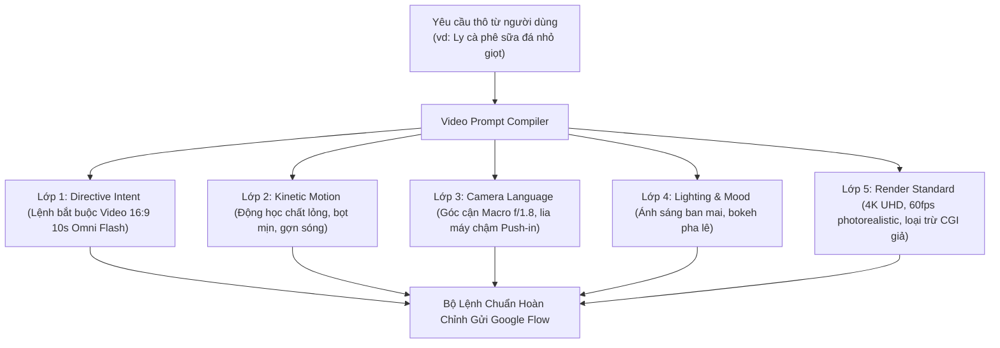

# BỘ LỆNH CHUYÊN DỤNG & HƯỚNG DẪN TẠO VIDEO GOOGLE FLOW (OMNI FLASH 10S)

> [!IMPORTANT]
> **Nguyên nhân cốt lõi đã được khắc phục:**
> 1. **Chế độ mặc định của Google Flow:** Nếu chỉ nhập câu văn miêu tả thông thường (ví dụ: *"Cảnh quay cận cảnh ly cà phê sữa đá..."*), tác nhân AI của Google Flow sẽ tự động rơi vào chế độ mặc định **tạo 2 hình ảnh tĩnh bằng mô hình Nano Banana 2.1**.
> 2. **Giải pháp Bộ Lệnh (Directive Compiler):** Hệ thống hiện tại đã tích hợp bộ biên dịch tự động, bắt buộc mở đầu bằng mệnh lệnh chỉ định mô hình video:  
>    `"Tạo 1 video 16:9 chất lượng điện ảnh (10 giây, mô hình Omni 1.1 Flash): [Nội dung yêu cầu]..."`  
>    nhờ đó Google Flow luôn nhận diện chính xác 100% và kích hoạt mô hình Omni Flash 10 giây.
> 3. **Chống kẹt Lockfile (Error 32):** Tích hợp `profile_guard` tự động dọn tiến trình mồ côi và mở khóa SMB trước khi khởi chạy Playwright.

---

## 1. Cấu Trúc Bộ Lệnh Video 5 Lớp (5-Layer Cinematic Directive)

Mỗi khi người dùng nhập yêu cầu thô sơ, Bộ biên dịch **Video Prompt Compiler** của hệ thống sẽ tự động cấu trúc hóa thành 5 lớp chỉ thị chuyên sâu:



### Bảng Phân Tích 5 Lớp Chi Tiết:

| Lớp Thành Phần | Mục Tiêu Kỹ Thuật | Ví Dụ Cụ Thể Trong Lệnh |
| :--- | :--- | :--- |
| **1. Directive Intent** | Ép Google Flow kích hoạt Video Engine | `Tạo 1 video 16:9 chất lượng điện ảnh (10 giây, mô hình Omni 1.1 Flash): ...` |
| **2. Camera Language** | Góc quay & chuyển động máy | `Cận cảnh đặc tả (Macro Extreme Close-Up), Chuyển động lia chậm (Slow Push-in), f/1.8 Shallow Depth of Field.` |
| **3. Kinetic Dynamics** | Động học vật lý chân thực | `Từng giọt cà phê nguyên chất màu hổ phách nhỏ chậm rãi xuống lớp sữa đặc, tạo gợn sóng lan tỏa và bọt mịn óng ánh.` |
| **4. Lighting & Mood** | Ánh sáng & bầu không khí | `Ánh sáng ban mai xuyên thấu qua khối đá pha lê, màu sắc tương phản ấm áp dịu mắt.` |
| **5. Render Quality** | Độ sắc nét & tốc độ khung hình | `4K UHD photorealistic, 60fps slow motion mượt mà, chân thực không CGI giả lập.` |

---

## 2. Điểm Móc 3 Giây Đầu (Retention Hook Strategy)

Để giữ chân người xem lướt TikTok/Shorts (mục tiêu Retention Rate > 70%):
- **Quy tắc 0 - 3 giây:** Phân cảnh video của Omni Flash phải bắt đầu ngay tại **điểm rơi cao trào chuyển động** (ví dụ: khoảnh khắc giọt nước chạm bề mặt, thao tác mở hộp dứt khoát, khói bốc lên ngùn ngụt).
- **Âm thanh Foley đồng bộ:** Ghép hiệu ứng tiếng giọt nước tí tách (drip SFX) hoặc tiếng click mở hộp cùng nhạc nền chuẩn **-14 LUFS**.

---

## 3. Hai Quy Trình Vận Hành Trên BAHA Creator Studio

Hệ thống hỗ trợ 2 quy trình song song linh hoạt cho nhà sáng tạo:

### Quy Trình 1: Tự Động Hoàn Toàn 0đ (Flow Engine Zero-Cost)
1. Truy cập `http://localhost:3000/ai-studio` $\to$ chọn tab **Tạo Video Dọc 9:16 (0đ)**.
2. Nhập ý tưởng đơn giản vào ô câu lệnh (ví dụ: *"Cảnh quay ly cà phê sữa đá nhỏ giọt"*).
3. Nhấn **Tối Ưu Bộ Lệnh & Xem Hướng Dẫn** để xem cấu trúc phân cảnh chuyên nghiệp.
4. Nhấn **Khởi Tạo Video Dọc 9:16 (0đ)**:
   - Hệ thống tự động biên dịch bộ lệnh 5 lớp.
   - Gửi sang Google Flow AI để kết xuất video gốc 16:9 (10 giây).
   - Tự động áp dụng **Blurred Canvas Outpainting** mở rộng thành định dạng dọc 9:16 (1080x1920) chuẩn TikTok mà không bị méo hình.

### Quy Trình 2: Bán Tự Động (Khi Google Cloud Quá Tải Hàng Đợi)
Khi Google Flow hiển thị thông báo *"Flow is currently experiencing high demand..."*:
1. Nhấn nút **Tối Ưu Bộ Lệnh** $\to$ nhấn **Sao chép lệnh**.
2. Dán trực tiếp vào tab trình duyệt [Google Flow](https://flow.google.com/) đang mở.
3. Khi Flow kết xuất xong video 10s, tải tệp `.mp4` về máy.
4. Trên AI Studio, nhấn nút **Tải Lên Video 16:9 (Flow Omni 10s)**:
   - Hệ thống mở rộng sang video dọc 9:16 TikTok ngay lập tức trong vài giây.
   - Sẵn sàng gắn nhạc nền Flow Music và xuất bản.

---

## 4. Bảng Mẫu Bộ Lệnh Cho Các Ngành Hàng Phổ Biến

### Mẫu 1: Ẩm Thực & Đồ Uống (F&B)
```text
Tạo 1 video 16:9 chất lượng điện ảnh (10 giây, mô hình Omni 1.1 Flash): Cảnh quay cận cảnh ly cà phê sữa đá nhỏ giọt dưới ánh nắng ban mai. Cận cảnh đặc tả (Macro Extreme Close-Up), Chuyển động lia chậm (Slow Push-in). Chi tiết động học: Từng giọt cà phê nguyên chất màu hổ phách nhỏ chậm rãi xuống lớp sữa đặc, tạo gợn sóng lan tỏa và bọt mịn óng ánh. Ánh sáng & không khí: Ánh nắng ban mai xuyên thấu qua khối đá pha lê, f/1.8 Shallow Depth of Field. Chất lượng hiển thị: 4K UHD photorealistic, 60fps slow motion mượt mà, màu sắc điện ảnh chân thực, không CGI giả lập.
```

### Mẫu 2: Đập Hộp Sản Phẩm Công Nghệ (Tech Unboxing)
```text
Tạo 1 video 16:9 chất lượng điện ảnh (10 giây, mô hình Omni 1.1 Flash): Cận cảnh bàn tay mở hộp chiếc điện thoại flagship viền titan bóng bẩy. Góc máy cận 45 độ (Hero Shot), camera tracking trượt ngang trên ray slider. Động học: Thao tác bóc seal dứt khoát, ánh sáng lướt qua mặt lưng kính mờ phản chiếu ánh sáng gradient tinh xảo. Ánh sáng: Softbox studio 3 điểm chiếu sáng dịu nhẹ, tương phản sắc sảo. 4K UHD photorealistic, 60fps.
```

### Mẫu 3: Review Món Ăn Nóng Hổi (Food Review)
```text
Tạo 1 video 16:9 chất lượng điện ảnh (10 giây, mô hình Omni 1.1 Flash): Bát phở bò tái lăn bốc khói nghi ngút trên bàn gỗ mộc. Góc quay 45 độ kết hợp Orbit xoay nhẹ quanh bát phở. Động học: Làn khói trắng bốc lên cuộn xoáy mờ ảo, nước dùng óng ánh mỡ gà vàng ươm, hành hoa tươi xanh. Ánh sáng đèn vàng ấm cúng chiều thu, độ sâu trường ảnh nông. 4K photorealistic, 60fps.
```
