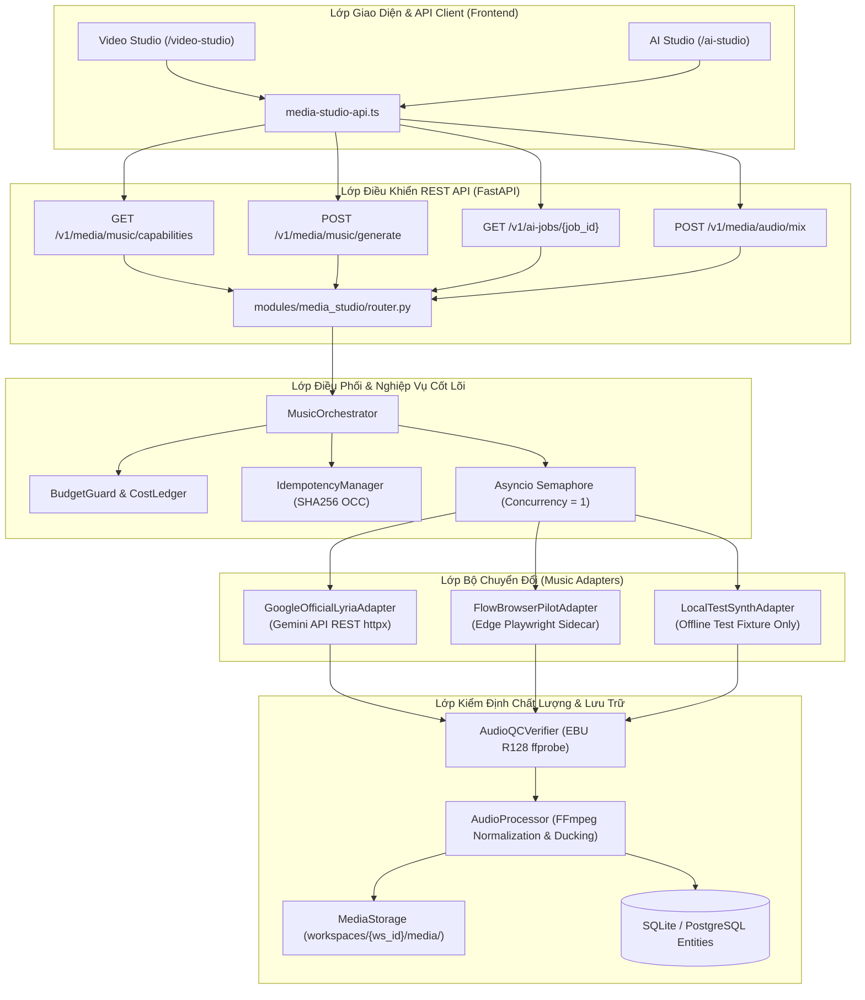
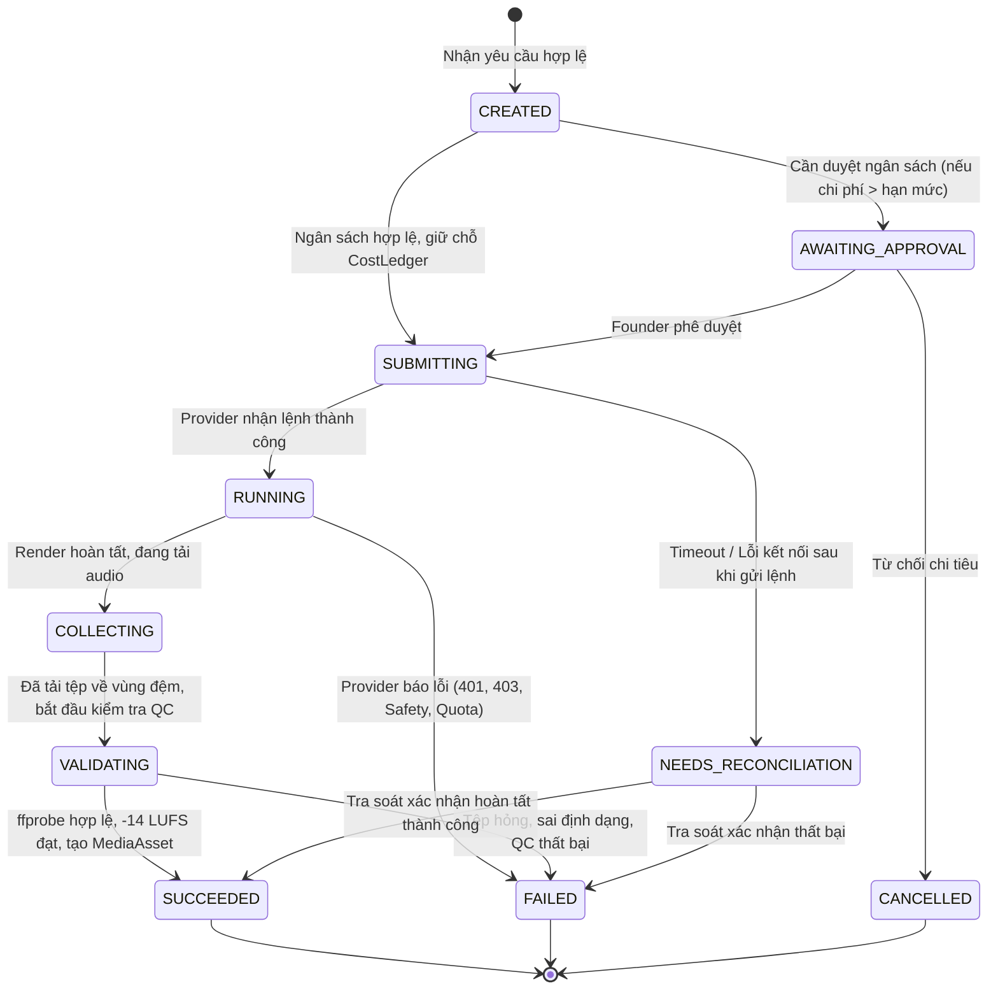

# Kế hoạch sửa đổi và nâng cấp phân hệ âm nhạc AI (Flow Music & Google Lyria) — Implementation Master Plan

> **Dành cho Agent triển khai (Antigravity & Codex):** Thực hiện tuần tự từng phase từ Phase 0 đến Phase 8; tuyệt đối không vượt cổng khi thiếu bằng chứng thực tế tại [08_kiem_thu/bang_chung/](file:///C:/PRJ_069_Sin_Xay_kenh/08_kiem_thu/bang_chung/). Đây là bản kế hoạch tổng thể kỹ thuật chi tiết, không phải ủy quyền tự động tiêu credits tài khoản Google hoặc công bố tính năng khi chưa kiểm chứng runtime thật.

- **Mã dự án:** PRJ_069 - Hệ thống sáng tạo nội dung BAHA Group
- **Phân hệ:** Media Studio / Music Engine (GF04 & P08/GF05)
- **Tiêu chuẩn quản trị:** BAHA_PROJECT_OS_STANDARD_TEMPLATE_V2
- **Tài liệu tham chiếu gốc:** [GOOGLE_FLOW_PHASES.md](file:///C:/PRJ_069_Sin_Xay_kenh/02_nguyen_ban_giai_nen/baha_creator_studio_flow_addendum_v1_1/BAHA_Group_Creator_Studio_Anti_Plan_v1_1/GOOGLE_FLOW_PHASES.md), [GOOGLE_FLOW_INTEGRATION_STRATEGY.md](file:///C:/PRJ_069_Sin_Xay_kenh/02_nguyen_ban_giai_nen/baha_creator_studio_flow_addendum_v1_1/BAHA_Group_Creator_Studio_Anti_Plan_v1_1/GOOGLE_FLOW_INTEGRATION_STRATEGY.md), và [GOOGLE_FLOW_ACCEPTANCE_CASES.json](file:///C:/PRJ_069_Sin_Xay_kenh/02_nguyen_ban_giai_nen/baha_creator_studio_flow_addendum_v1_1/BAHA_Group_Creator_Studio_Anti_Plan_v1_1/GOOGLE_FLOW_ACCEPTANCE_CASES.json).
- **Mục tiêu cốt lõi:** Loại bỏ triệt để việc sinh âm thanh procedural giả mạo (sine wave FFmpeg) đang mạo danh Lyria API hoặc Flow Music; thiết lập adapter API chính thức Google Lyria (Lyria 3 Clip và Lyria 3.5); cô lập Flow Browser Automation thành sidecar thử nghiệm nội bộ; triển khai đo lường âm lượng thực tế EBU R128 (-14 LUFS ± 1 LUFS); và bảo vệ tính lũy đẳng, cô lập đa khách thuê cùng rào chắn Bốn Mắt (Separation of Duties).

---

## I. Hướng dẫn tiếp quản nhanh dưới 2 phút (Fast Resume Protocol)

Bất kỳ Kỹ sư hoặc AI Agent nào khi tiếp quản công việc này cần nắm vững 4 sự thật kỹ thuật sau:
1. **Hiện trạng lỗi cốt lõi:** Class [`OfficialLyriaProvider`](file:///C:/PRJ_069_Sin_Xay_kenh/03_ban_lam_viec/sin_content_api/src/modules/media_studio/music_provider.py#L110) hiện đang chạy lệnh FFmpeg tổng hợp các sóng hình sin đơn âm (sine chord C-Am-F-G) rồi tự ý gán nhãn `GEMINI_LYRIA_API`, đóng dấu `approval_state = "APPROVED"` và ghi nhận chi phí giả định $0.05. Tương tự, [`FlowMusicZeroCostProvider`](file:///C:/PRJ_069_Sin_Xay_kenh/03_ban_lam_viec/sin_content_api/src/modules/media_studio/music_provider.py#L24) sinh âm thanh tổng hợp tương tự trong môi trường test và tự nhận là `FLOW_MUSIC`. Toàn bộ hành vi này vi phạm nghiêm trọng Nguyên tắc Vàng 1 (Ground Truth > Self-Report).
2. **Trạng thái kiểm định âm thanh:** Hàm [`AudioProcessor.normalize_loudness`](file:///C:/PRJ_069_Sin_Xay_kenh/03_ban_lam_viec/sin_content_api/src/modules/media_studio/audio_processor.py#L56) hiện chỉ áp dụng filter `loudnorm` rồi tự gán `meta["target_lufs"] = -14.0` mà không hề đo lường âm lượng thực tế (Integrated Loudness LUFS, True Peak dBTP) của tệp đầu ra.
3. **Mô hình mục tiêu:** Tách bạch 3 adapter riêng biệt:
   - `GoogleOfficialLyriaAdapter`: Gọi Google Gemini API Interactions REST chính thức qua `httpx` với model `lyria-3-clip-preview` (clip 30s) và `lyria-3.5` (bài hát dài).
   - `FlowBrowserPilotAdapter`: Sidecar Playwright Edge nội bộ, tắt mặc định (`FLOW_MUSIC_PILOT_ENABLED=false`), chỉ kích hoạt khi có phiên đăng nhập của chủ tài khoản.
   - `LocalTestSynthAdapter`: Dành riêng cho test fixture offline, trả rõ nhãn `LOCAL_TEST_SYNTH`, không mạo nhận AI provider.
4. **Không gian làm việc:** Chỉ chỉnh sửa trong [03_ban_lam_viec/](file:///C:/PRJ_069_Sin_Xay_kenh/03_ban_lam_viec/) và cập nhật trạng thái tại [00_bat_dau/CURRENT_STATE.md](file:///C:/PRJ_069_Sin_Xay_kenh/00_bat_dau/CURRENT_STATE.md).

---

## II. Giao thức chống suy đoán khi thi công (Truth Table)

Bảng đối soát thực tế mã nguồn hiện hành (Kiểm kê ngày 2026-10-23):

| Nhận định kỹ thuật | Trạng thái | Bằng chứng trong repo / Hành động khắc phục bắt buộc |
|---|---|---|
| `OfficialLyriaProvider` gọi Google Lyria API thật | ĐÃ ĐỐI SOÁT (SAI LỆCH) | [music_provider.py](file:///C:/PRJ_069_Sin_Xay_kenh/03_ban_lam_viec/sin_content_api/src/modules/media_studio/music_provider.py#L110-L175): Hàm `_generate_rich_melody` chạy FFmpeg sinh sine wave nội bộ, dán nhãn `GEMINI_LYRIA_API` và gán cứng `actual_cost = 0.05`. **BẮT BUỘC SỬA**: Thay thế bằng `GoogleOfficialLyriaAdapter` gọi REST endpoint chính thức của Gemini API qua `httpx`. |
| `FlowMusicZeroCostProvider` sinh nhạc theo prompt người dùng | ĐÃ ĐỐI SOÁT (SAI LỆCH) | [music_provider.py](file:///C:/PRJ_069_Sin_Xay_kenh/03_ban_lam_viec/sin_content_api/src/modules/media_studio/music_provider.py#L70-L72): Khi `TESTING=1` hoặc `APP_ENV=test`, gọi `_generate_rich_melody` sinh giai điệu procedural cố định, bỏ qua hoàn toàn prompt người dùng. **BẮT BUỘC SỬA**: Tách rõ `LocalTestSynthAdapter` cho test fixture; provider production phải trả trạng thái lỗi rõ ràng khi không có mạng/phiên. |
| Quá trình tạo nhạc tự phong trạng thái `APPROVED` | ĐÃ ĐỐI SOÁT (SAI LỆCH) | [music_provider.py](file:///C:/PRJ_069_Sin_Xay_kenh/03_ban_lam_viec/sin_content_api/src/modules/media_studio/music_provider.py#L217): `approval_state="APPROVED"` được gán trực tiếp khi tạo `MediaAsset`, vi phạm nguyên tắc Bốn Mắt (Separation of Duties). **BẮT BUỘC SỬA**: Gán mặc định `approval_state="UNREVIEWED"`; bắt buộc quy trình phê duyệt độc lập. |
| `AudioProcessor` đo đạc chuẩn xác -14 LUFS | ĐÃ ĐỐI SOÁT (THIẾU SÓT) | [audio_processor.py](file:///C:/PRJ_069_Sin_Xay_kenh/03_ban_lam_viec/sin_content_api/src/modules/media_studio/audio_processor.py#L56-L85): Chỉ chạy lệnh `ffmpeg -af loudnorm` và trả về `target_lufs = -14.0`, không trích xuất thông số đo thực tế. **BẮT BUỘC SỬA**: Chạy lệnh đo đạc 2-pass hoặc parse JSON `loudnorm=print_format=json` để lấy `input_i`, `input_tp`, `input_lra` thực tế. |
| Có endpoint kiểm tra năng lực (Capabilities Probe) | ĐÃ ĐỐI SOÁT (THIẾU SÓT) | [router.py](file:///C:/PRJ_069_Sin_Xay_kenh/03_ban_lam_viec/sin_content_api/src/modules/media_studio/router.py): Chỉ có `POST /v1/media/music/generate`, hoàn toàn thiếu `GET /v1/media/music/capabilities`. Frontend không thể biết model nào khả dụng. **BẮT BUỘC SỬA**: Bổ sung endpoint capabilities probe. |
| Endpoint tạo nhạc hỗ trợ xử lý tác vụ bất đồng bộ | ĐÃ ĐỐI SOÁT (THIẾU SÓT) | [router.py](file:///C:/PRJ_069_Sin_Xay_kenh/03_ban_lam_viec/sin_content_api/src/modules/media_studio/router.py#L220-L252): Thực hiện đồng bộ trong request HTTP, nguy cơ timeout và không có theo dõi tiến độ Job. **BẮT BUỘC SỬA**: Đấu nối với bảng `AIGenerationJob`, trả mã Job ngay và hỗ trợ polling trạng thái qua `/v1/ai-jobs/{job_id}`. |
| Khóa lũy đẳng chống trừ chi phí trùng lặp (Idempotency) | ĐÃ ĐỐI SOÁT (THIẾU SÓT) | [router.py](file:///C:/PRJ_069_Sin_Xay_kenh/03_ban_lam_viec/sin_content_api/src/modules/media_studio/router.py#L221): Không nhận `idempotency_key` từ client; nếu client gửi lại do mạng chập chờn sẽ sinh 2 lần và trừ tiền 2 lần. **BẮT BUỘC SỬA**: Nhận header `X-Idempotency-Key`, kiểm tra trùng lặp và chặn submit lại. |
| Flow Music Client tải clip không xác thực định danh | ĐÃ ĐỐI SOÁT (NGUY CƠ) | [flow_music_client.py](file:///C:/PRJ_069_Sin_Xay_kenh/03_ban_lam_viec/cong_cu_tu_dong/flow_bridge/flow_music_client.py#L186-L198): Khi không lấy được clip theo project, client tự động tải clip mới nhất từ `clips/auth-user`, có thể lấy nhầm sản phẩm của tác vụ khác. **BẮT BUỘC SỬA**: Bắt buộc đối soát `project_id` và timestamp, fail-closed nếu không khớp. |
| Model Google Lyria được tài liệu chính thức hỗ trợ | ĐÃ ĐỐI SOÁT | Tài liệu Google AI for Developers (2026-10-23): Công bố `lyria-3-clip-preview` (clip 30s) và `lyria-3.5` (bài dài) qua Gemini API Interactions REST; hỗ trợ MP3 44.1kHz stereo, nhúng SynthID. |
| Quản trị phần cứng tác vụ nặng Concurrency = 1 | ĐÃ ĐỐI SOÁT (THIẾU SÓT) | Chưa có cơ chế khóa phân tán hoặc Semaphore trong `music_orchestrator`, có thể gây tràn VRAM GPU hoặc quá tải tiến trình FFmpeg. **BẮT BUỘC SỬA**: Thêm asyncio Semaphore / process lock với concurrency = 1. |

---

## III. Ràng buộc toàn cục & Tiêu chuẩn kỹ thuật (Golden Rules)

Mọi dòng mã, kiểm thử và tài liệu trong kế hoạch này phải tuân thủ nghiêm ngặt:
1. **Ranh giới vùng ghi (Authorized Write Scope):** Chỉ chỉnh sửa tại [03_ban_lam_viec/](file:///C:/PRJ_069_Sin_Xay_kenh/03_ban_lam_viec/) và các tệp trạng thái tại [00_bat_dau/](file:///C:/PRJ_069_Sin_Xay_kenh/00_bat_dau/). Cấm can thiệp vào [01_nguon_goc_bat_bien/](file:///C:/PRJ_069_Sin_Xay_kenh/01_nguon_goc_bat_bien/) hoặc [02_nguyen_ban_giai_nen/](file:///C:/PRJ_069_Sin_Xay_kenh/02_nguyen_ban_giai_nen/).
2. **Quy chuẩn ngôn ngữ & Đặt tên:** Tên tệp và thư mục 100% Tiếng Việt không dấu viết thường ngăn cách bằng gạch dưới (snake_case); nội dung tài liệu, mã nguồn và giao diện 100% Tiếng Việt có dấu chuẩn mực.
3. **Tuyệt đối không dùng Icon / Emoji — Bắt buộc dùng SVG (Golden Rule 9):** Nghiêm cấm ký tự emoji hoặc unicode icon trong giao diện UI, mã nguồn, tài liệu và log. Biểu tượng phải dùng vector SVG chuẩn (Lucide SVG).
4. **Không rò rỉ thông tin bí mật (No Secrets in Repo):** Tuyệt đối không hardcode API key, cookie, bearer token hoặc mật khẩu trong mã nguồn, test fixture hoặc tệp bằng chứng. Sử dụng biến môi trường hoặc Secret Vault.
5. **Tiêu chuẩn âm thanh TikTok chuẩn mực:**
   - Định dạng đầu ra: MP3, CBR/VBR ≥ 192 kbps, tần số lấy mẫu 44.100 Hz hoặc 48.000 Hz, 2 kênh (Stereo).
   - Âm lượng tích hợp (Integrated Loudness): `-14.0 LUFS` với dung sai cho phép `±1.0 LU` (khoảng nghiệm thu: `[-15.0, -13.0] LUFS`).
   - Đỉnh cực đại thực tế (Maximum True Peak): `≤ -1.5 dBTP` nhằm loại bỏ hiện tượng méo tiếng khi nén âm trên nền tảng TikTok.
   - Kỹ thuật Auto-Ducking: Nhạc nền tự động giảm `-18.0 dB` khi có giọng đọc thuyết minh và khôi phục mượt mà khi giọng đọc dừng.
6. **Quản trị phần cứng:** Giới hạn xử lý đồng thời `Concurrency = 1` cho các tác vụ sinh âm thanh AI và encode FFmpeg.
7. **Cách ly đa khách thuê (Tenant Boundary):** Mọi tác vụ và tệp âm thanh phải gắn chặt với `workspace_id`. Tuyệt đối không cho phép khách thuê A truy cập hoặc tra soát tác vụ của khách thuê B.

---

## IV. Kiến trúc mục tiêu & Sơ đồ luồng dữ liệu (Target Architecture)

Hệ thống điều phối âm nhạc mới được thiết kế theo kiến trúc tách lớp lục giác (Hexagonal Architecture):



### Vòng đời trạng thái tác vụ âm nhạc (Music Job State Machine)



---

## V. Kế hoạch triển khai chi tiết 9 Phase (Phases 0 — 8)

---

### Phase 0 — Kiểm kê runtime và đối soát sự thật mã nguồn (Audited Runtime Inventory)

**Mục tiêu:** Chốt chặn toàn bộ thông số runtime, phiên bản phần mềm, cấu hình hiệu lực và mã băm SHA256 của các tệp nguồn mà không thực hiện gọi API có tính phí.

#### 1. Kiểm kê môi trường thực tế (Ground Truth Environment)
- **Hệ điều hành:** Windows 10/11 x64.
- **Python Runtime:** Python 3.11.9 (`C:\tools\python-embed\python.exe`).
- **FFmpeg & FFprobe:** Phiên bản 9.0.2-full_build (`gyan.dev`), hỗ trợ bộ lọc `loudnorm`, `sidechaincompress`, `ebur128`.
- **Thư viện HTTP:** `httpx 0.27.0` (Sẵn sàng trong runtime, không cần cài thêm thư viện ngoài).
- **Thư viện Google GenAI SDK:** `google.genai` chưa cài đặt trong môi trường. Do đó, adapter chính thức sẽ sử dụng `httpx` gọi trực tiếp REST API của Gemini Interactions để đảm bảo triết lý Ponytail Minimalist.

#### 2. Kiểm kê mã băm SHA256 các tệp cốt lõi hiện hành
- [`music_provider.py`](file:///C:/PRJ_069_Sin_Xay_kenh/03_ban_lam_viec/sin_content_api/src/modules/media_studio/music_provider.py): 9.482 bytes — SHA256: `21bacd1f050bf9a6b5adc14cd585898ddf9cb84a2706751af06f8a986e9d45be`.
- [`router.py`](file:///C:/PRJ_069_Sin_Xay_kenh/03_ban_lam_viec/sin_content_api/src/modules/media_studio/router.py): 24.522 bytes — SHA256: `479da441bd40b396a5970526676a0be05bb95cacea497d998c0f7c703d10aab6`.
- [`audio_processor.py`](file:///C:/PRJ_069_Sin_Xay_kenh/03_ban_lam_viec/sin_content_api/src/modules/media_studio/audio_processor.py): 6.058 bytes — SHA256: `234ca647348d51ca864adfae3e9f2d2c07036aab7e8e448e40d911d771aeba83`.
- [`entities.py`](file:///C:/PRJ_069_Sin_Xay_kenh/03_ban_lam_viec/sin_content_api/src/models/entities.py): 42.015 bytes — SHA256: `cbab8662d3a6175244c6e56cc7b338ea4e3118ddb90a64db2f6bafac383dd9ca`.
- [`contracts.py`](file:///C:/PRJ_069_Sin_Xay_kenh/03_ban_lam_viec/sin_content_api/src/schemas/contracts.py): 34.269 bytes — SHA256: `7596a6c601898111c9574b5e1d846e8699f6fdc8442b396df42c0670e0b03ef7`.
- [`test_media_studio_music.py`](file:///C:/PRJ_069_Sin_Xay_kenh/03_ban_lam_viec/sin_content_api/tests/test_media_studio_music.py): 13.463 bytes — SHA256: `80e40827dbda1276ab30bb1c9fa585a920e413858d1c42af6418ea78a3c2da42`.
- [`flow_music_client.py`](file:///C:/PRJ_069_Sin_Xay_kenh/03_ban_lam_viec/cong_cu_tu_dong/flow_bridge/flow_music_client.py): 11.446 bytes — SHA256: `3bd7ca229d04a705ac21c281549535e1fa4d1d9df86c7249f01e57654a36fe03`.
- [`media-studio-api.ts`](file:///C:/PRJ_069_Sin_Xay_kenh/03_ban_lam_viec/sin_creator_os/src/lib/api/media-studio-api.ts): 11.273 bytes — SHA256: `1196aed907398515912ff9d51113777814e14ecc5157df8b2f78c39f779c1a7d`.

#### 3. Ma trận năng lực các Provider âm nhạc (Capability Matrix)

| Provider ID | Tên sản phẩm | Model ID | Chế độ | Độ dài | Định dạng | Trạng thái quyền | Chi phí ước tính |
|---|---|---|---|---|---|---|---|
| `GOOGLE_OFFICIAL_API` | Google Lyria 3 Clip | `lyria-3-clip-preview` | `CLIP_30S` | Cố định 30 giây | MP3 44.1kHz Stereo | Cần Google AI Studio API Key | Theo biểu giá Gemini API |
| `GOOGLE_OFFICIAL_API` | Google Lyria 3.5 | `lyria-3.5` | `FULL_SONG` | 60 — 180 giây | MP3 44.1kHz Stereo | Cần Google AI Studio API Key | Theo biểu giá Gemini API |
| `FLOW_BROWSER_PILOT` | Flow Music Plus Web | `flow-music-web` | `PILOT_BROWSER` | 30 — 120 giây | M4A/MP3 | Cần phiên đăng nhập Edge | 0đ (Gói Pro 10.000 credits) |
| `LOCAL_TEST_SYNTH` | Bộ tổng hợp kiểm thử | `test-synth-v1` | `TEST_FIXTURE` | Tùy biến (5 — 30s) | MP3 -14 LUFS | Nội bộ offline (0đ) | 0.0 USD |

#### 4. Tiêu chí vượt cổng Phase 0 (Exit Gate Phase 0)
- [ ] Hoàn tất bảng kiểm kê SHA256 và cấu hình không lộ thông tin bí mật.
- [ ] Chạy import probe xác nhận toàn bộ module backend nạp thành công mà không kích hoạt gọi mạng bên ngoài.
- [ ] Đánh dấu rõ ràng các tệp mã nguồn tạo âm thanh procedural giả mạo cần loại bỏ.

---

### Phase 1 — Chốt mô hình sản phẩm, hợp đồng DTO và State Machine

**Mục tiêu:** Định nghĩa hợp đồng dữ liệu chuẩn hóa, chấm dứt việc dùng chung một nhãn "Flow Music" cho các cơ chế khác nhau; thiết lập Pydantic DTOs và TypeScript interfaces đồng bộ 100%.

#### 1. Định nghĩa Hợp đồng DTO (Pydantic Schemas trong `contracts.py`)

```python
from enum import Enum
from typing import Optional, List, Dict, Any
from pydantic import BaseModel, Field, ConfigDict

class MusicProviderType(str, Enum):
    GOOGLE_OFFICIAL = "GOOGLE_OFFICIAL"
    FLOW_BROWSER_PILOT = "FLOW_BROWSER_PILOT"
    LOCAL_TEST_SYNTH = "LOCAL_TEST_SYNTH"

class MusicGenerationMode(str, Enum):
    CLIP_30S = "CLIP_30S"           # Lyria 3 Clip (cố định 30 giây)
    FULL_SONG = "FULL_SONG"         # Lyria 3.5 (bài hát đầy đủ)
    PILOT_ASSISTED = "PILOT_ASSISTED" # Flow Music web automation
    SYNTH_FIXTURE = "SYNTH_FIXTURE" # Test fixture nội bộ

class MusicJobStatus(str, Enum):
    CREATED = "CREATED"
    AWAITING_APPROVAL = "AWAITING_APPROVAL"
    SUBMITTING = "SUBMITTING"
    RUNNING = "RUNNING"
    COLLECTING = "COLLECTING"
    VALIDATING = "VALIDATING"
    SUCCEEDED = "SUCCEEDED"
    FAILED = "FAILED"
    NEEDS_RECONCILIATION = "NEEDS_RECONCILIATION"

class MusicGenerateRequest(BaseModel):
    prompt: str = Field(..., min_length=3, max_length=1000, description="Mô tả phong cách, giai điệu hoặc nội dung âm nhạc")
    genre: str = Field("Pop", max_length=50, description="Thể loại nhạc (Pop, Acoustic, Lo-Fi, Rock, Electronic...)")
    mood: str = Field("Upbeat", max_length=50, description="Tâm trạng bản nhạc (Upbeat, Relaxing, Energetic, Emotional...)")
    lyrics: Optional[str] = Field(None, max_length=2000, description="Lời bài hát kèm thẻ phân đoạn [Verse], [Chorus] nếu có")
    provider: MusicProviderType = Field(MusicProviderType.GOOGLE_OFFICIAL, description="Nhà cung cấp âm nhạc mục tiêu")
    mode: MusicGenerationMode = Field(MusicGenerationMode.CLIP_30S, description="Chế độ sinh nhạc")
    duration_sec: int = Field(30, ge=5, le=180, description="Thời lượng mong muốn (bắt buộc 30s với Lyria Clip)")
    project_id: Optional[str] = Field(None, description="ID dự án sản xuất liên kết")
    idempotency_key: str = Field(..., min_length=8, max_length=128, description="Khóa chống trùng lặp request")

class MusicQCReport(BaseModel):
    measured_i_lufs: float = Field(..., description="Âm lượng tích hợp đo đạc thực tế theo EBU R128 (LUFS)")
    measured_tp_dbtp: float = Field(..., description="Đỉnh cực đại thực tế đo đạc (dBTP)")
    measured_lra_lu: float = Field(..., description="Dải biến thiên âm lượng (LRA)")
    target_lufs: float = Field(-14.0, description="Mục tiêu chuẩn hóa TikTok (-14 LUFS)")
    passed: bool = Field(..., description="Đạt chuẩn kiểm định kỹ thuật")
    sample_rate_hz: int = Field(44100, description="Tần số lấy mẫu âm thanh")
    channels: int = Field(2, description="Số kênh âm thanh")

class MusicCapabilityItem(BaseModel):
    provider: MusicProviderType
    mode: MusicGenerationMode
    model_id: str
    enabled: bool
    blocked_reason: Optional[str] = None
    max_duration_sec: int
    cost_per_generation_usd: float
    requires_approval: bool
    observed_at: str

class MusicCapabilitiesResponse(BaseModel):
    workspace_id: str
    items: List[MusicCapabilityItem]
    default_provider: MusicProviderType
    pilot_enabled: bool
```

#### 2. Đồng bộ TypeScript Interfaces trên Frontend (`sin_creator_os/src/contracts/music.ts`)
- Định nghĩa các kiểu `MusicProviderType`, `MusicGenerationMode`, `MusicJobStatus`.
- Giao diện `MusicGenerateParams` nhận đầy đủ `idempotency_key`, `mode`, `provider`.
- Giao diện `MusicJobResponse` hiển thị `job_id`, `state`, `progress_percent`, `qc_report`.

#### 3. Chuẩn hóa Bảng Mã Lỗi (Structured Error Codes)

| Mã lỗi | HTTP Status | Ý nghĩa & Hướng dẫn xử lý cho Client |
|---|---|---|
| `FLOW_LOGIN_REQUIRED` | 401 | Chưa đăng nhập phiên Google Flow trên Edge. Yêu cầu chạy `00_DANG_NHAP_GOOGLE_FLOW.cmd`. |
| `CREDENTIALS_MISSING` | 503 | Chưa cấu hình Google Gemini API Key trong hệ thống. |
| `MODEL_UNAVAILABLE` | 502 | Model Lyria không khả dụng hoặc chưa mở quyền cho tài khoản. |
| `REGION_UNAVAILABLE` | 403 | Tính năng âm nhạc bị giới hạn địa lý tại khu vực của tài khoản. |
| `PROMPT_SAFETY_VIOLATION` | 422 | Câu lệnh vi phạm chính sách an toàn (bản quyền nghệ sĩ, từ ngữ độc hại). |
| `QUOTA_EXCEEDED` | 429 | Đã sử dụng hết hạn mức API hoặc hạn ngạch tín dụng tháng. |
| `AUDIO_QC_FAILED` | 502 | Tệp âm thanh sinh ra không đạt chuẩn âm lượng hoặc bị méo tiếng/hỏng tệp. |
| `IDEMPOTENCY_CONFLICT` | 409 | Khóa `idempotency_key` đã tồn tại nhưng payload yêu cầu có sự sai khác. |
| `NEEDS_RECONCILIATION` | 202 | Yêu cầu đã gửi tới provider nhưng gặp timeout mạng. Đang chờ tra soát tự động. |

#### 4. Tiêu chí vượt cổng Phase 1 (Exit Gate Phase 1)
- [ ] Toàn bộ schemas Pydantic và TypeScript contracts được đối soát 1:1.
- [ ] Unit tests cho validation schemas: Từ chối payload sai thời lượng (ví dụ: Lyria Clip yêu cầu khác 30s), từ chối provider không hỗ trợ.

---

### Phase 2 — Triển khai Google Official Lyria Adapter & Capability Probe

**Mục tiêu:** Xây dựng adapter chính thức kết nối Google Gemini API Interactions để sinh nhạc từ prompt thật; loại bỏ 100% mã nguồn procedural sine wave.

#### 1. Thiết kế `GoogleOfficialLyriaAdapter`
- Tệp thực thi: [`sin_content_api/src/modules/media_studio/official_lyria_adapter.py`](file:///C:/PRJ_069_Sin_Xay_kenh/03_ban_lam_viec/sin_content_api/src/modules/media_studio/official_lyria_adapter.py).
- Kết nối: Sử dụng `httpx.AsyncClient` hoặc `httpx.Client` với timeout phân tách: `connect=10.0s`, `read=120.0s`.
- Endpoint REST chính thức:
  `POST https://generativelanguage.googleapis.com/v1beta/models/{model_id}:generateContent?key={API_KEY}`
- Phân tích phản hồi:
  1. Duyệt qua mảng `candidates[0].content.parts`.
  2. Bóc tách `inlineData.data` (chuỗi Base64 audio), giải mã sang mảng bytes MP3 thật.
  3. Bóc tách phần `text` chứa thông tin cấu trúc bài hát (`[Verse]`, `[Chorus]`) và lời nhạc.
  4. Xác nhận sự hiện diện của watermark SynthID.

#### 2. Cơ chế Capability Probe (`inspect_capabilities`)
- Kiểm tra tính hợp lệ của API Key và quyền hạn của model `lyria-3-clip-preview` và `lyria-3.5`.
- Nếu API Key không tồn tại: Trả trạng thái `enabled = False`, `blocked_reason = "CREDENTIALS_MISSING"`.
- Nếu API trả lỗi quyền hạn (403): Trả `enabled = False`, `blocked_reason = "ACCOUNT_NOT_ENTITLED"`.
- Không gọi hàm sinh nhạc thật trong quá trình probe để bảo vệ hạn ngạch.

#### 3. Loại bỏ mã giả mạo (Elimination of Procedural Synthesis)
- Xóa bỏ hoàn toàn hàm `_generate_rich_melody` trong [`OfficialLyriaProvider`](file:///C:/PRJ_069_Sin_Xay_kenh/03_ban_lam_viec/sin_content_api/src/modules/media_studio/music_provider.py#L117).
- Chuyển logic sinh âm thanh kiểm thử sang `LocalTestSynthAdapter` riêng biệt, chỉ kích hoạt khi cờ `provider == "LOCAL_TEST_SYNTH"`.

#### 4. Tiêu chí vượt cổng Phase 2 (Exit Gate Phase 2)
- [ ] Kiểm thử Offline Contract Test (Mock Transport) bao phủ 100% các nhánh: Thành công, lỗi 401, lỗi 403, lỗi 429 Quota, lỗi Safety Filter, và phản hồi Base64 hỏng.
- [ ] Không có bất kỳ cuộc gọi mạng thực tế nào diễn ra trong bộ test mặc định.
- [ ] Secret Scanner quét sạch 0 khóa API hoặc token trong mã nguồn.

---

### Phase 3 — Quản lý Job bất đồng bộ, Lũy đẳng và Hạch toán ngân sách

**Mục tiêu:** Đảm bảo không mất dấu tác vụ, không trừ tiền 2 lần khi mạng timeout hoặc người dùng bấm lặp lại.

#### 1. Quản lý lũy đẳng bền vững (Persistent Idempotency)
- Thuật toán băm khóa:
  `idempotency_hash = SHA256(f"{workspace_id}:{user_id}:{provider}:{mode}:{prompt}:{duration_sec}:{lyrics}")`
- Khi nhận request có `idempotency_key`:
  1. Truy vấn bảng `AIGenerationJob` theo `(workspace_id, idempotency_key)`.
  2. Nếu đã tồn tại và hash payload trùng khớp: Trả về thông tin Job hiện tại mà không gửi lệnh sang Provider.
  3. Nếu đã tồn tại nhưng hash payload khác nhau: Trả mã lỗi `HTTP 409 IDEMPOTENCY_CONFLICT`.

#### 2. Hạch toán chi phí và giữ chỗ ngân sách nguyên tử (Atomic Budget Reservation)
- Trước khi gọi Provider:
  1. Kiểm tra số dư khả dụng trong `WorkspaceBudget`.
  2. Thực hiện giữ chỗ chi phí ước tính (ví dụ: 0.05 USD đối với Lyria API).
  3. Ghi một bản ghi trạng thái `RESERVED` vào `CostLedger`.
- Sau khi Provider trả kết quả:
  1. Cập nhật `CostLedger` sang trạng thái `CONFIRMED` với chi phí thực tế.
  2. Nếu thất bại: Hoàn trả lại số dư giữ chỗ trong `WorkspaceBudget` và cập nhật ledger sang `RELEASED`.

#### 3. Xử lý timeout và đối soát sự cố (`NEEDS_RECONCILIATION`)
- Nếu gửi yêu cầu sang Provider thành công nhưng kết nối bị ngắt trước khi nhận tệp âm thanh:
  - Tuyệt đối **CẤM RETRY TỰ ĐỘNG**.
  - Đánh dấu trạng thái Job là `NEEDS_RECONCILIATION`.
  - Lưu trữ `provider_job_id` và timestamp vào metadata.
  - Cung cấp tiện ích tra soát đối chiếu hóa đơn nhà cung cấp trước khi quyết định hoàn tất hoặc hủy bỏ.

#### 4. Tiêu chí vượt cổng Phase 3 (Exit Gate Phase 3)
- [ ] Kiểm thử Fault Injection: Mô phỏng timeout ngay sau khi gửi lệnh -> Kiểm tra hệ thống chuyển sang `NEEDS_RECONCILIATION` và không phát sinh cuộc gọi thứ hai.
- [ ] Kiểm thử cô lập khách thuê: Khách thuê A không thể đọc thông tin Job của khách thuê B qua `/v1/ai-jobs/{job_id}`.
- [ ] Kiểm thử Race Condition: Bắn 5 request đồng thời cùng một `idempotency_key` -> Chỉ duy nhất 1 lệnh được xử lý, 4 lệnh còn lại nhận kết quả của lệnh đầu.

---

### Phase 4 — Bộ kiểm định chất lượng âm thanh thật (Audio QC Engine & TikTok Normalization)

**Mục tiêu:** Đo đạc chính xác các thông số âm lượng theo chuẩn EBU R128; từ chối mọi tệp âm thanh không đạt chuẩn; không công nhận kết quả chỉ dựa trên cấu hình FFmpeg.

#### 1. Thuật toán đo âm lượng thực tế (Ground Truth Measurement Algorithm)
Sử dụng FFprobe / FFmpeg phân tích tệp âm thanh đầu ra:
```bash
ffmpeg -i <duong_dan_tep_mp3> -af loudnorm=print_format=json -f null -
```
Trích xuất khối JSON từ `stderr`:
- `input_i`: Âm lượng tích hợp thực tế (Integrated Loudness, LUFS).
- `input_tp`: Đỉnh cực đại thực tế (True Peak, dBTP).
- `input_lra`: Dải biến thiên âm lượng (Loudness Range, LU).

#### 2. Tiêu chí kiểm định nghiệm thu âm thanh (QC Pass Rules)
- **Kiểm định cấu trúc tệp:**
  - File size > 50.000 bytes (tránh file rỗng hoặc file lỗi).
  - Magic bytes hợp lệ của MP3 (`ID3` hoặc `0xFF 0xFB`).
  - ffprobe xác nhận codec `mp3`, tần số lấy mẫu `44100` hoặc `48000 Hz`, số kênh = `2` (Stereo).
  - Thời lượng âm thanh thực tế sai lệch không quá ±1.0 giây so với cấu hình.
- **Kiểm định âm lượng TikTok:**
  - `-15.0 LUFS <= input_i <= -13.0 LUFS` (Mục tiêu -14 LUFS ± 1 LUFS).
  - `input_tp <= -1.5 dBTP` (Đảm bảo không bị xé âm thanh).
- **Hành vi khi kiểm định thất bại:**
  - Đánh dấu Job trạng thái `FAILED` với mã lỗi `AUDIO_QC_FAILED`.
  - Xóa bỏ tệp âm thanh hỏng khỏi kho lưu trữ.
  - Tuyệt đối không tạo bản ghi `MediaAsset` cho tệp thất bại.

#### 3. Tiêu chí vượt cổng Phase 4 (Exit Gate Phase 4)
- [ ] Kiểm thử trên các tệp audio mẫu (âm thanh chuẩn, âm thanh quá nhỏ -24 LUFS, âm thanh quá to -6 LUFS bị xé tiếng): Bộ kiểm định phân loại chính xác ĐẠT / KHÔNG ĐẠT.
- [ ] Test trường hợp tệp HTML giả mạo (lỗi mạng trả về trang lỗi 200 dạng HTML): Bộ kiểm định phát hiện và loại bỏ ngay từ bước magic bytes.

---

### Phase 5 — Cô lập và siết chặt Flow Browser Pilot (Tùy chọn, Isolated Sidecar)

**Mục tiêu:** Quản lý an toàn công cụ tự động hóa trình duyệt Flow Music web; tuyệt đối không để bot làm sập backend chính hoặc hoạt động khi chưa có phiên đăng nhập.

#### 1. Nguyên tắc cô lập triệt để
- `FLOW_MUSIC_PILOT_ENABLED = false` theo mặc định.
- Backend API chính không tự động import Playwright hoặc `flow_music_client.py` khi khởi động (Lazy load hoặc Sidecar Process riêng).
- Không truyền mật khẩu Google hoặc session cookies qua API request.

#### 2. Khắc phục lỗi bảo mật & Rủi ro định danh
- Loại bỏ hoàn toàn fallback lấy clip ngẫu nhiên từ `clips/auth-user` trong [`flow_music_client.py`](file:///C:/PRJ_069_Sin_Xay_kenh/03_ban_lam_viec/cong_cu_tu_dong/flow_bridge/flow_music_client.py#L186). Bắt buộc phải ánh xạ chính xác `project_id` sinh ra trong phiên.
- Quản lý khóa Profile Edge: Trước khi mở trình duyệt, kiểm tra và dọn dẹp khóa `ProcessSingleton` cục bộ nhằm tránh đụng độ với các phiên Edge đang mở trên Windows.
- Bắt lỗi phiên: Khi phát hiện thiếu Bearer Token hoặc phiên hết hạn, trả ngay ngoại lệ `FlowLoginRequired` và dừng tiến trình an toàn; không tự ý bypass CAPTCHA.

#### 3. Tiêu chí vượt cổng Phase 5 (Exit Gate Phase 5)
- [ ] Khi chưa chạy `00_DANG_NHAP_GOOGLE_FLOW.cmd`, lệnh gọi tạo nhạc qua Flow Pilot trả về mã lỗi `FLOW_LOGIN_REQUIRED` (HTTP 401).
- [ ] Trình duyệt chạy ở chế độ headless không làm rò rỉ cổng remote debugging ra ngoài localhost.

---

### Phase 6 — Tích hợp Frontend UI (`sin_creator_os`) & Trạng thái trung thực

**Mục tiêu:** Cung cấp trải nghiệm tạo nhạc minh bạch, chuyên nghiệp trên giao diện Next.js; phản ánh trung thực năng lực và trạng thái của hệ thống.

#### 1. Nâng cấp Client Service (`media-studio-api.ts`)
- Bổ sung hàm `getMusicCapabilities()` gọi `GET /v1/media/music/capabilities`.
- Cập nhật hàm `generateMusic()` gửi đầy đủ `idempotency_key`, `provider`, `mode`, `duration_sec`.
- Bổ sung cơ chế Polling theo dõi trạng thái Job qua `/v1/ai-jobs/{job_id}` với thanh tiến độ thời gian thực.

#### 2. Tích hợp Giao diện Phòng Dựng Video (`/video-studio/[projectId]`)
- **Vị trí tích hợp:** Tab Âm Nhạc (Music Inspector) và Modal Tạo Nhạc AI.
- **Bộ điều khiển đầu vào:**
  - Ô nhập Prompt mô tả giai điệu.
  - Ô nhập Lời bài hát (chỉ kích hoạt khi chọn model `lyria-3.5`).
  - Dropdown chọn Thể loại (Pop, Acoustic, Lo-Fi, Cinematic, Hip-Hop, Rock, EDM...).
  - Dropdown chọn Tâm trạng (Upbeat, Relaxing, Energetic, Dramatic, Melancholy...).
  - Bộ chọn Thời lượng (Duration): Tự động khóa cố định **30 giây** khi chọn Lyria 3 Clip; cho phép tùy chọn 60s/90s/120s khi chọn Lyria 3.5.
  - Bộ chọn Nhà cung cấp (Provider Selector): Chỉ hiển thị các Provider có trạng thái `enabled = True` từ Capabilities API.
- **Hệ thống nhãn trạng thái trực quan (100% SVG Vector Lucide — Không Emoji):**
  - Trạng thái Chờ: Biểu tượng Đồng hồ cát SVG (`Clock`).
  - Trạng thái Đang tạo: Biểu tượng Vòng xoay SVG (`Loader2 animate-spin`).
  - Trạng thái Kiểm định QC: Biểu tượng Khiên bảo vệ SVG (`ShieldCheck`).
  - Trạng thái Thành công: Biểu tượng Tích xanh SVG (`CheckCircle2`).
  - Trạng thái Lỗi / Cần tra soát: Biểu tượng Cảnh báo tam giác SVG (`AlertTriangle`).
- **Trình phát nghe thử (Audio Preview Player):**
  - Hiển thị dạng sóng âm (Waveform), thanh trượt thời gian, nút Play/Pause.
  - Hiển thị nhãn kiểm định: `Chuẩn TikTok -14 LUFS (Đã đo đạc)`.
  - Nút hành động: "Chèn vào Timeline Video" và "Lưu vào Thư viện Media".

#### 3. Tiêu chí vượt cổng Phase 6 (Exit Gate Phase 6)
- [ ] Giao diện render chính xác, không phát sinh lỗi console.
- [ ] Không có request tạo nhạc tự động chạy ngầm khi mới mở hoặc render lại trang.
- [ ] Kiểm tra toàn bộ mã nguồn frontend: Đạt chuẩn Golden Rule 9 (**0 emoji, 100% SVG**).
- [ ] Kiểm tra kiểu tĩnh TypeScript: `pnpm exec tsc --noEmit` đạt Exit code 0.

---

### Phase 7 — An ninh, Phân quyền RBAC, Bản quyền & Vận hành

**Mục tiêu:** Đảm bảo hệ thống được bảo vệ vững chắc theo mô hình RBAC chuẩn BAHA Group; tuân thủ nguyên tắc Bốn Mắt và bảo vệ bản quyền âm nhạc.

#### 1. Kiểm soát phân quyền RBAC đa khách thuê
- Action guard bắt buộc trên endpoint tạo nhạc: `require_action("music.generate")`.
- Chỉ các vai trò có quyền (ví dụ: `WORKSPACE_OWNER`, `CREATOR_LEAD`) mới được tạo yêu cầu sinh nhạc có tính phí.
- Endpoint tải tư liệu âm thanh được bảo vệ bởi token có thời hạn (TTL) và xác thực `workspace_id`.

#### 2. Thực thi nguyên tắc Bốn Mắt (Separation of Duties)
- Tệp âm thanh sinh ra từ AI ban đầu có trạng thái `approval_state = "UNREVIEWED"`.
- Người tạo (User tạo job) không được phép tự phê duyệt bản nhạc của chính mình sang trạng thái `APPROVED`. Bắt buộc phải có một người kiểm duyệt độc lập (Reviewer / Lead) phê duyệt trước khi đưa vào video xuất bản chính thức.

#### 3. Bộ lọc An toàn Thương hiệu & Bản quyền (Brand Safety & Rights Guard)
- Chặn đứng các prompt yêu cầu đạo nhái giọng ca sĩ cụ thể (ví dụ: "hát bằng giọng ca sĩ X") hoặc chứa lời bài hát đã đăng ký bản quyền thương mại.
- Ghi nhận trạng thái `PROMPT_SAFETY_VIOLATION` và từ chối gửi lệnh sang Provider.

#### 4. Tiêu chí vượt cổng Phase 7 (Exit Gate Phase 7)
- [ ] Kiểm thử RBAC: Tài khoản không có quyền bị chặn với mã lỗi HTTP 403 Forbidden.
- [ ] Kiểm thử Separation of Duties: Hành động tự phê duyệt bị từ chối với mã lỗi HTTP 403.
- [ ] Rà soát an ninh mã nguồn T012: Quét toàn bộ mã nguồn, 0 vi phạm rò rỉ token hoặc credentials.

---

### Phase 8 — Canary Staging, Nghiệm thu Live Ground Truth & Phát hành

**Mục tiêu:** Tiến hành nghiệm thu thực tế theo quy trình 6 tầng nghiêm ngặt; chỉ kích hoạt sản phẩm ra ngoài khi có đầy đủ bằng chứng thực tế tại `08_kiem_thu/bang_chung/`.

#### 1. Quy trình nghiệm thu 6 tầng (6-Tier Verification Hierarchy)
1. **Tầng 1 (Offline Unit & Contract Tests):** Kiểm tra toàn bộ logic xử lý, schemas, state machine và adapters với fake transport (100% Green).
2. **Tầng 2 (Local Integration Tests):** Kiểm tra tích hợp FFmpeg, đo lường EBU R128 thật trên các tệp mẫu, kiểm tra CSDL SQLite.
3. **Tầng 3 (Capabilities Probe Live):** Gọi probe kiểm tra trạng thái tài khoản và hạn mức mà không sinh âm thanh.
4. **Tầng 4 (Controlled Live Generation):** Thực hiện đúng 1 lần sinh nhạc thật với model được phê duyệt, có văn bản chấp thuận chi phí của Founder.
5. **Tầng 5 (Diễn tập khôi phục khẩn cấp - Rollback Drill):** Tắt cờ tính năng `FEATURE_FLAG_MUSIC_GENERATION=false` và kiểm chứng hệ thống Video Studio vẫn hoạt động bình thường với các tư liệu âm thanh tự tải lên.
6. **Tầng 6 (Biên bản nghiệm thu & GO/NO-GO):** Ban hành biên bản nghiệm thu `CP_MUSIC_EVIDENCE.md` và trình Founder phê duyệt.

#### 2. Bộ bằng chứng nghiệm thu bắt buộc (Evidence Artifacts Checklist)
Mọi báo cáo hoàn tất phải lưu tại thư mục [08_kiem_thu/bang_chung/](file:///C:/PRJ_069_Sin_Xay_kenh/08_kiem_thu/bang_chung/) bao gồm:
- Tệp log thực thi lệnh có ngày giờ, phiên bản runtime và exit code 0.
- Tệp âm thanh thành phẩm MP3 kèm mã băm SHA256 và kích thước bytes.
- Kết quả trích xuất `ffprobe` và kết quả đo đạc JSON `loudnorm` chứng minh đạt `-14 LUFS ± 1 LUFS`.
- Ảnh chụp màn hình giao diện Next.js hiển thị trạng thái sinh nhạc thành công và thanh waveform.
- Phiếu xác nhận hạch toán chi phí `CostLedger` khớp đúng với hóa đơn nhà cung cấp.

---

## VI. Ma trận ca kiểm thử chuẩn hóa (Acceptance Test Matrix GF04)

Bảng đối soát 12 ca kiểm thử chuẩn hóa theo tài liệu gốc `GOOGLE_FLOW_ACCEPTANCE_CASES.json`:

| Mã Test | Tên ca kiểm thử | Chế độ | Điều kiện đầu vào | Kết quả mong đợi bắt buộc | Lệnh kiểm thử thực tế |
|---|---|---|---|---|---|
| **GF04-01** | Lyria 3 Clip 30s Generation | LIVE | Tài khoản có quyền, yêu cầu clip 30s | Sinh tệp MP3 30s đọc được, ghi nhận metadata, trạng thái rights pending | `pytest tests/test_media_studio_music.py -k test_gf04_01` |
| **GF04-02** | Lyria Full-Song Generation | LIVE | Model bài dài được kích hoạt | Sinh bài hát đầy đủ, lưu model ID, lời và cấu trúc phân đoạn | `pytest tests/test_media_studio_music.py -k test_gf04_02` |
| **GF04-03** | Model / Region Unavailable | OFFLINE | Model hoặc khu vực bị khóa | Trả mã `REGION_UNAVAILABLE` hoặc `MODEL_UNAVAILABLE`, không fallback âm thầm | `pytest tests/test_media_studio_music.py -k test_gf04_03` |
| **GF04-04** | Auto-Ducking Voice & Music Mix | OFFLINE | Track giọng đọc + track nhạc nền | FFmpeg hạ nhạc -18dB khi có giọng, căn chỉnh thời lượng, không mất tiếng | `pytest tests/test_media_studio_music.py -k test_gf04_04` |
| **GF04-05** | Rights & Impersonation Filter | OFFLINE | Yêu cầu nhái giọng ca sĩ / đạo lời | Bộ lọc bản quyền phát hiện, từ chối tạo tệp, trả mã `PROMPT_SAFETY_VIOLATION` | `pytest tests/test_media_studio_music.py -k test_gf04_05` |
| **GF04-06** | Prompt Safety Filtering | OFFLINE | Provider trả kết quả bị filter | Ghi nhận trạng thái filter, không tạo tệp âm thanh giả | `pytest tests/test_media_studio_music.py -k test_gf04_06` |
| **GF04-07** | Flow Pilot Region Blocked | MANUAL | Khu vực tài khoản bị hạn chế | Trả trạng thái `BLOCKED`, không thực hiện fake IP hay giả mạo định danh | `pytest tests/test_media_studio_music.py -k test_gf04_07` |
| **GF04-08** | Instrumental Mode Constraints | OFFLINE | Yêu cầu lời trên model chỉ hòa tấu | Thông báo giới hạn chỉ hòa tấu, không hứa hẹn sai năng lực | `pytest tests/test_media_studio_music.py -k test_gf04_08` |
| **GF04-09** | True EBU R128 Measurement | OFFLINE | Tệp âm thanh sau chuẩn hóa | Đo đạc JSON thực tế đạt `-15.0 <= input_i <= -13.0` LUFS, `tp <= -1.5` dBTP | `pytest tests/test_media_studio_music.py -k test_gf04_09` |
| **GF04-10** | Persistent Idempotency & Budget | OFFLINE | 2 request trùng `idempotency_key` | Trả cùng kết quả, không gọi Provider lần 2, không trừ phí trùng lặp | `pytest tests/test_media_studio_music.py -k test_gf04_10` |
| **GF04-11** | Separation of Duties Gate | OFFLINE | Người tạo yêu cầu tự duyệt asset | Hệ thống từ chối HTTP 403, bắt buộc người kiểm duyệt độc lập | `pytest tests/test_media_studio_music.py -k test_gf04_11` |
| **GF04-12** | Session Revocation Fail-Closed | OFFLINE | Phiên Flow hết hạn / thiếu cookie | Trả mã `FLOW_LOGIN_REQUIRED` (401), dừng tiến trình an toàn | `pytest tests/test_media_studio_music.py -k test_gf04_12` |

---

## VII. Kế hoạch hoàn tác an toàn và ứng phó sự cố (Safe Rollback Protocol)

Trong trường hợp phát sinh sự cố nghiêm trọng trên môi trường thử nghiệm hoặc vận hành:
1. **Khóa khẩn cấp tính năng (Kill Switch):** Thiết lập biến môi trường `FEATURE_FLAG_MUSIC_GENERATION=false`. Endpoint tạo nhạc sẽ lập tức trả mã HTTP 503 thông báo tính năng đang bảo trì, hoàn toàn không làm gián đoạn tính năng dựng video hoặc upload tư liệu sẵn có trong Video Studio.
2. **Khôi phục trạng thái mã nguồn:** Sử dụng điểm phục hồi an toàn đã lưu tại `90_sao_luu/` trước khi áp dụng các thay đổi lớn.
3. **Bảo toàn dữ liệu đã ghi nhận:** Các bản ghi `CostLedger` và `MediaAsset` đã tạo trước thời điểm sự cố được giữ nguyên tính bất biến; không thực hiện lệnh xóa hàng loạt (Hard Delete) trên cơ sở dữ liệu.

---

## VIII. Phân định vai trò và bàn giao ca (Dual-Agent Collaboration)

Theo quy định tại [AGENTS.md](file:///C:/PRJ_069_Sin_Xay_kenh/AGENTS.md):
- **Antigravity (Kiến trúc sư & Kiểm định chất lượng):**
  - Chịu trách nhiệm quy hoạch kiến trúc, thiết lập bản kế hoạch tổng thể này.
  - Kiểm định toàn diện các tiêu chí qua cổng (Exit Gates) từ Phase 0 đến Phase 8.
  - Thực hiện kiểm toán an ninh ranh giới, rà soát mã bí mật và Golden Rule 9 (NO EMOJI - SVG ONLY).
  - Cập nhật trang hành trình [hanh_trinh_phat_trien_069.html](file:///C:/PRJ_069_Sin_Xay_kenh/hanh_trinh_phat_trien_069.html) và trạng thái dự án tại [00_bat_dau/CURRENT_STATE.md](file:///C:/PRJ_069_Sin_Xay_kenh/00_bat_dau/CURRENT_STATE.md).
- **Codex (Chuyên viên thực thi mã nguồn chi tiết):**
  - Triển khai adapter `GoogleOfficialLyriaAdapter` và cải tiến `AudioProcessor` đo đạc EBU R128 thật tại `03_ban_lam_viec/sin_content_api/`.
  - Loại bỏ triệt để mã giả lập procedural sine wave trong `OfficialLyriaProvider`.
  - Viết bộ unit tests và contract tests tương ứng với 12 ca kiểm thử GF04.
  - Bàn giao kết quả và nhật ký kỹ thuật cho Antigravity đối soát nghiệm thu.

---

## IX. Kết luận và cam kết tuân thủ Ground Truth

Kế hoạch này khẳng định triết lý cốt lõi của BAHA Group: **Sự thật trên hết (Ground Truth > Self-Report)**. Mọi tính năng âm nhạc AI chỉ được coi là sẵn sàng khi đã vượt qua các bài kiểm tra định lượng với bằng chứng kỹ thuật không thể chối cãi. Không có chỗ cho sự giả mạo, báo cáo khống hay ảo tưởng năng lực trong toàn bộ hệ thống.
