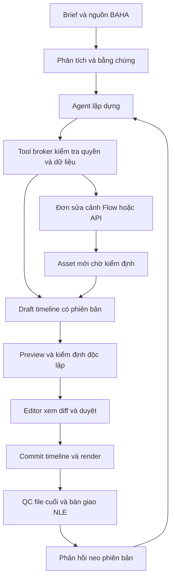

# Đặc tả harness dựng và sửa video chuyên nghiệp cho BAHA

Phiên bản đề xuất 1.0, ngày 23/10/2026. Trạng thái: thiết kế để duyệt, chưa triển khai. Nguồn: yêu cầu Founder và [nghiên cứu có đối soát](nghien_cuu_harness_dung_video_2026_10_23.md). Mọi hợp đồng mới dưới đây là đề xuất, không phải API/code hiện hữu.

## 1. Mục tiêu và điều kiện bắt đầu

Tối ưu toàn bộ chu trình dựng video của BAHA từ ảnh, footage, âm thanh và brief: hiểu tư liệu, lập phương án, dựng nhiều lớp, hậu kỳ, sửa cảnh bằng Flow, sửa theo phản hồi, tạo biến thể và bàn giao bản xuất cùng project còn chỉnh sửa được. Agent thao tác trên công cụ thật, giữ nguồn và các quyết định của editor; con người có thể tiếp quản bất kỳ lúc nào.

Chỉ bắt đầu triển khai sau khi **M-P7 của plan media-first đã được nghiệm thu bằng artifact thật**: upload ảnh/video, timeline lưu/mở lại, preview, render và bảo vệ workspace. H00 phải xác minh lại sau khi plan trước hoàn tất. Không coi nghiên cứu hiện tại là M-P7 PASS. Nếu plan nền tảng thay đổi schema/API thì cập nhật mapping trước khi thực thi task phụ thuộc.

Không mở rộng publishing hay RBAC Production trong kế hoạch này. Bản cuối vẫn theo quy trình duyệt hiện hành. Bổ sung action/grant, nếu cần, là một thay đổi phải tuân theo guardrail RBAC của dự án.

## 2. Định nghĩa hoàn thành một công việc dựng

Một job đạt phải có: brief/preset có version; danh sách nguồn và SHA256; bằng chứng nội dung theo timecode; bản dựng và lịch sử thay đổi; file xem độc lập; báo cáo QC; quyết định duyệt của người có quyền; gói project mở lại được; danh sách phần đã render thành lớp phẳng và lý do nếu có. Agent trả lời “đã sửa” chỉ sau readback đúng phiên bản và, khi yêu cầu liên quan đầu ra, kiểm tra trên render.

Đo tối ưu bằng thời gian editor thao tác, số vòng sửa, tỷ lệ duyệt, chi phí và lỗi. Không dùng số tool hoặc số clip tạo làm chỉ số hoàn thành.

## 3. Luồng nghiệp vụ bắt buộc

1. **Dựng từ footage:** nạp nguồn, đồng bộ audio, phân tích, chọn đoạn, storyboard/rough cut, fine cut, audio/caption/color, QC, duyệt, giao.
2. **Dựng từ ảnh:** ảnh sản phẩm/thương hiệu, chuyển động bằng keyframe hoặc ảnh sang video, VO/nhạc được cấp quyền, chữ chuẩn, nhiều tỷ lệ khung hình.
3. **Sửa một bản dựng:** người dùng chỉ clip/timecode, ghi “giữ nguyên” các phần khác; agent tạo patch trên draft, so sánh trước/sau, xác minh không ảnh hưởng ngoài phạm vi.
4. **Sửa nội dung một cảnh bằng Flow:** lấy đúng nguồn/đoạn và reference, tạo yêu cầu thay đổi kèm phần phải giữ; chọn assisted UI hoặc API chính thức; nhận asset mới, kiểm định, ghép lại có duyệt.
5. **Hậu kỳ chuyên sâu:** màu, mask, tracking, compositing, retime và audio finishing qua engine/NLE được chọn; phần API chưa thao tác được phải thành task editor rõ ràng, không thành công giả.
6. **Nhân bản đầu ra:** bản master sang 9:16/16:9/1:1, độ dài khác nhau, caption có/không, ngôn ngữ được duyệt; revision riêng, QC riêng, không tạo lại AI nếu chỉ đổi packaging.
7. **Bàn giao và quay lại sửa:** xuất project, relink media, mở trên máy editor, sửa thật, nhập revision kế tiếp; bảo toàn nhánh trước, không coi MP4 phẳng là project editable.

## 4. Ma trận năng lực chuyên nghiệp phải được phủ

`BAHA` nghĩa là thực thi qua lõi/renderer BAHA; `NLE` nghĩa là adapter phần mềm dựng hoặc editor thực hiện có artifact; `AI` nghĩa là API hosted hoặc Flow assisted. H02 chọn nơi thực thi từng chức năng, H06/H09 nghiệm thu. Năng lực chỉ đánh dấu `AGENT_EXECUTABLE` nếu đã có tool chạy và readback; thao tác editor được gắn `HUMAN_REQUIRED`.

| Mã | Nhóm | Tối thiểu phải nghiệm thu | Nơi thực thi đề xuất |
|---|---|---|---|
| C01 | Quản lý tư liệu | Batch import, checksum/dedupe trong workspace, bins/tags, proxy, relink, orientation/timecode | BAHA |
| C02 | Hiểu nội dung | ASR tiếng Việt, word IDs, phân cảnh, visual evidence, tìm đoạn theo ý nghĩa | BAHA + AI |
| C03 | Lập dựng | Brief, shot list, hook/story/CTA theo loại job, rough cut có lý do và reference | Agent trên dữ liệu đã kiểm tra |
| C04 | Dựng thời gian | Split, trim, insert, overwrite, ripple, slip, gap, marker, linked A/V, khóa track | BAHA/engine |
| C05 | Nhiều lớp | Ít nhất 3 video layer, 4 audio layer trong fixture; B-roll, PiP, logo, transition | Engine/NLE |
| C06 | Chữ và phụ đề | SRT/ASS, từ/câu, sửa chính tả theo glossary, font hợp lệ, template, safe zone | BAHA/engine |
| C07 | Hậu kỳ âm thanh | Dialogue/music/SFX, sync, fade, J/L cut, gain envelope, EQ/compressor, ducking, loudness; lọc nhiễu chỉ qua đường được phép | Engine/NLE; AI hosted nếu dùng |
| C08 | Bố cục và chuyển động | Crop/reframe, vị trí/tỷ lệ/opacity, keyframe/easing, giữ subject và vùng chữ qua nhiều tỷ lệ | Engine/NLE; AI đề xuất |
| C09 | Màu | Exposure/WB/contrast/saturation, LUT có quyền, shot matching, màu nguồn/đích rõ; HDR/Log phải conform có duyệt | Engine/NLE |
| C10 | Compositing | Mask/crop/keying, theo dõi vùng qua thời gian, chèn đồ họa, blur/redaction; kiểm tra mọi frame vùng nhạy cảm | Engine/NLE; không mặc định có AI local |
| C11 | Tốc độ và đa camera | Speed/freeze/reverse, source-time mapping; sync và chọn góc từ 2 camera + audio rời | Engine/NLE |
| C12 | Sửa và tạo tư liệu | Flow sửa ảnh, ảnh sang video, first/last/reference, edit footage, continuation khi model hỗ trợ | Assisted UI hoặc API chính thức |
| C13 | Phản hồi | Comment neo clip/version/timecode, patch giới hạn phạm vi, diff, so sánh, chấp nhận/từ chối/undo | BAHA |
| C14 | Tái sử dụng | Brand kit, glossary, title/lower-third/outro, preset kênh, batch variants, template có version | BAHA |
| C15 | Xuất và bàn giao | MP4, clean master, captions/stems khi cần, project native/trao đổi, relink/roundtrip | BAHA + NLE |
| C16 | Vận hành | Dừng/tiếp tục, quyền, ngân sách, retry có giới hạn, trace, queue bền vững và rollback | BAHA |

H12 chỉ đóng toàn bộ kế hoạch khi C01–C16 đều có bằng chứng đạt và đạt mức agent tối thiểu bên dưới. Một nhóm còn thiếu thì chỉ có thể nghiệm thu mốc từng phần, trạng thái kế hoạch vẫn chưa hoàn tất. Không hứa mọi effect của mọi NLE; chức năng chuyên sâu ngoài mức tối thiểu chưa có tool phải hiển thị HUMAN_REQUIRED hoặc UNSUPPORTED và giao task editor rõ ràng.

Mức tối thiểu agent phải trực tiếp thực thi qua tool và readback: C01 nhập/proxy/relink; C02 phân tích/tìm đoạn; C03 tạo rough cut; C04 các lệnh thời gian; C05 dựng nhiều lớp; C06 tạo/sửa phụ đề; C07 sync/gain/fade/duck/loudness; C08 crop/keyframe; C09 chỉnh exposure/WB/saturation và áp dụng LUT có quyền; C10 mask vùng đơn giản/keying và áp dụng quỹ đạo tracking đã có bằng chứng; C11 speed/freeze/reverse và chọn góc từ nguồn đã sync; C12 sửa ảnh, ảnh sang video và sửa video qua API chính thức; C13 sửa theo comment và undo; C14 áp template/tạo biến thể; C15 xuất/render/gói project; C16 tiếp tục sau restart và thực thi giới hạn. Tạo task cho editor không thay thế những thao tác tối thiểu này. Fine grading, roto phức tạp, mix thẩm mỹ và quyết định duyệt cuối vẫn có thể do editor thực hiện. First/last/reference/continuation của C12 có test riêng theo route đã xác minh; chức năng chưa khả dụng không được ghi đã hỗ trợ, và không chặn hoàn thành nếu ba đường bắt buộc trên đã đạt và giới hạn này được Founder chấp nhận tại H01.

## 5. Kiến trúc và quyền quyết định

Một agent điều phối, một bên được ghi mỗi draft, kiểm định chỉ đọc. Dùng cùng lõi thao tác cho người và agent. Agent không được SQL/shell/path tùy ý, truy cập cookie hoặc gọi trực tiếp local MCP của engine ngoài broker. Không bắt buộc dùng một framework agent mới; dùng HTTP client, validation, job/storage của BAHA sau kiểm kê.

Cho phép tự động đọc, lập draft, sửa draft và render preview trong phạm vi/quota đã được cấp cho phiên. Quyền cấp theo project, action, revision, ngân sách và hạn dùng; không hỏi lại cho mỗi thao tác đã được cấp. Tạo/sửa media bên ngoài phải nằm trong ngân sách và chính sách dữ liệu đã duyệt. Duyệt bản cuối do người có quyền; agent không tự đổi APPROVED/PUBLISH_READY.

## 6. Hợp đồng dữ liệu bắt buộc

Tất cả schema mới có `schema_version`, từ chối field lạ, giá trị NaN/Infinity và boolean giả integer. Workspace/actor lấy từ session server, không tin workspace do model gửi. Hash do server tính trên JSON canonical UTF-8, keys sắp xếp, không NaN; dấu tiếng Việt giữ nguyên, không tự viết lại nội dung.

| Hợp đồng | Trường và bất biến |
|---|---|
| `DinhDanhPhien` | `run_id`, `project_id`, `actor_id`, `base_revision`, `base_hash`, `policy_version`; revision/hash/quyền phải còn khớp trước side effect |
| `ChinhSachPhien` | `policy_version`, action allowlist, dữ liệu được gửi provider nào, trần USD và credit riêng, deadline, giới hạn turn/tool/repair/generation; chữ ký/ID grant do server cấp |
| `BangChungNguon` | `evidence_id`, `asset_id`, `source_sha256`, `analysis_version`, modality, source range, word/frame IDs, provider/model/request ID nếu có, `confidence` nullable; quan sát và suy luận tách riêng |
| `ThoiGianNguon` | `{ticks:int,time_base_num:int,time_base_den:int}`; mẫu số/tử số dương; giây = ticks * num / den; video dùng PTS nguồn, không tính bằng float FPS |
| `TimelineV2` | `schema_version=2`, fps hữu tỷ, resolution/color/audio profile, tracks/clips IDs ổn định, `source_in/out` theo ThoiGianNguon, `start_frame`, `duration_frames`, link/lock, typed effect và map nguồn |
| `KeHoachDung` | `plan_id`, ràng buộc brief, evidence IDs, version nền, thao tác đề xuất, thiếu bằng chứng, báo giá và capability version; không thể tự cấp quyền |
| `LenhDung` | `operation_id`, `draft_id`, `expected_draft_revision`, `type`, typed payload, evidence IDs, phạm vi clip/track; không chứa lệnh shell hoặc storage path |
| `KetQuaCongCu` | `operation_id`, status enum, revision/hash sau thao tác, `changed_ids`, artifact IDs đã kiểm tra, error code/retry class, cost units; chuỗi thông báo không quyết định thành công |
| `DonSuaCanh` | request ID, project/draft/base version, source asset/hash/range, target clip ID, reference IDs/roles, prompt và constraints đã duyệt, preserve list, audio policy, delivery/length policy, route/model/capability version, budget grant |
| `BienBanKiemDinh` | timeline/render hash, engine/version, profile, kết quả từng kiểm tra, mức bằng chứng, reviewer, các giới hạn; thiếu dữ liệu trả UNKNOWN/REVIEW_REQUIRED |
| `GoiBanGiao` | manifest nguồn/derivative, revision/hash, file xuất, captions/stems, project native/định dạng trao đổi, mapping effect, fonts/LUT/license refs, hướng dẫn relink và giới hạn |

Các type được khai báo ở `hop_dong.py`; tên viết tắt `CanhSua` trong tool bên dưới chính là `DonSuaCanh`, không tạo schema thứ hai. `PhanHoiDung` thêm `feedback_id`, revision/frame hoặc clip/source-range đã neo, loại sửa, preserve list và người yêu cầu. `MauThuongHieu` có ID/version/hash, palette/fonts/glossary/safe-zone và preset đầu ra; không học chéo workspace.

### Timeline v1 và thời gian

Giữ các version cũ nguyên trạng. Đọc v1 của plan trước qua bộ chuyển đổi có version; millisecond chuyển chính xác thành rational 1/1000 trước khi lượng tử hóa về frame đích. VFR phải có mapping PTS nguồn sang proxy và timeline; không lấy frame index chia avg FPS. Nguồn v1 thiếu map không tự nâng thành “frame accurate”. Speed/reverse/freeze/multicam phải lưu map rõ ràng. Thay đổi source làm mất hiệu lực evidence liên quan.

Hiệu ứng có tên/type và tham số allowlist, không chứa JavaScript/FFmpeg filter expression từ model. Quyết định mapping effect của engine do H02/H03 chốt bằng schema appendix; phía engine không hỗ trợ phải reject trước commit hoặc tạo gói finishing đã duyệt, không drop effect.

## 7. Bộ công cụ agent đề xuất

Tên tool/API mới chỉ được gọi sau khi task tương ứng tạo và nghiệm thu. HTTP BAHA là ranh giới chuẩn; MCP facade chỉ ánh xạ cùng service nếu agent thực tế cần, không tạo quyền thứ hai.

| Tool | Đầu vào cốt lõi | Kết quả và quyền |
|---|---|---|
| `doc_du_an` | project ID, revision | Snapshot có hash/capabilities/locks; chỉ đọc |
| `tim_tu_lieu` | project, truy vấn, evidence version | Asset/word/frame refs và nguồn; không bịa nội dung |
| `xem_doan` | asset ID, source range, mục tiêu quan sát | Frame/audio preview có timecode; broker giới hạn dữ liệu |
| `tao_ban_nhap` | base revision/hash, run grant | Draft riêng; không sửa timeline live |
| `sua_ban_nhap` | draft, expected draft revision, list LenhDung | Transaction all-or-nothing, readback sau thao tác |
| `xem_khac_biet` | draft, base revision | Diff theo clip/range, phần bị ảnh hưởng và chi phí |
| `xuat_xem_truoc` | draft revision/hash, profile ID | Job/file preview; quota và snapshot cố định |
| `yeu_cau_sua_canh` | DonSuaCanh | Đơn assisted hoặc job API; chưa ghép kết quả |
| `nhan_ket_qua_canh` | request, output asset ID, provenance | Asset chờ QC; không thay clip live |
| `kiem_dinh_ban_dung` | revision/hash, render asset nếu có | Báo cáo độc lập, không tự APPROVED |
| `trinh_duyet` | draft/hash, QC IDs | Review task neo đúng nội dung |
| `ghi_nhan_ban_dung` | draft/hash, base revision, approval ID | Version mới duy nhất; stale/locked bị từ chối |
| `khoi_phuc_phien_ban` | source revision, current revision, grant | Tạo version mới có nội dung tương đương bản cũ, không xóa lịch sử |
| `xuat_goi_ban_giao` | revision/hash, adapter/profile | Gói kiểm tra mở lại; không báo đã mở nếu chỉ xuất file |

Union LenhDung gồm split/trim/insert/overwrite/ripple/slip/remove/move, link/unlink, set gain/caption/transform/transition/color/mask/retime, marker và lựa chọn góc camera. Payload phải có định nghĩa field/range cụ thể ở H03 và chỉ expose loại engine đã chứng minh hỗ trợ. Mọi group op có precondition và thay đổi ảnh hưởng đi kèm: captions, linked audio, transition handles, evidence mapping.

## 8. Vòng agent và phục hồi

Phiên điều phối có trạng thái: `CREATED -> ANALYZING -> PLANNING -> EDITING -> PREVIEWING -> QC_PENDING -> REVIEW_PENDING -> COMPLETED`. Có thể sang `WAITING_HUMAN`, `WAITING_PROVIDER`, `CONFLICT`, `FAILED`, `CANCELLED` hoặc `NEEDS_RECONCILIATION`. Chỉ COMPLETED khi artifact đúng revision đã đạt yêu cầu; WAITING không đổi thành thành công. Job provider có vòng đời riêng, không trộn với approval của timeline.

Mỗi bước thực hiện: đọc snapshot -> kiểm tra grant/capability -> gọi tool -> readback -> ghi event/next step. Event append-only có run/op/revision/hash/provider ID/cost/error, không chứa key/cookie. Checkpoint lưu brief, plan, nguồn, pending ops, provider job IDs và hành động kế tiếp; khởi động lại phải tra job cũ trước khi tạo job mới. Không ghi transcript suy luận nội bộ của model; lưu quyết định và bằng chứng cần kiểm toán.

Checkpoint sửa hội thoại còn bắt buộc lưu từng yêu cầu đã làm sạch, quan hệ previous interaction, tham chiếu các asset đã tải và SHA, lựa chọn người dùng đã duyệt, cost reservation/usage, draft/native hash cuối. Không chỉ lưu URI tạm của provider. Nếu session provider hết hạn hoặc policy không cho store, phiên đi SESSION_EXPIRED: tiếp tục từ asset cục bộ đã xác minh bằng một yêu cầu mới chỉ khi route cho phép upload lại và còn grant/budget; ghi rõ đây là lượt mới, không bảo đảm tái tạo nguyên trạng ngữ cảnh hội thoại. Không còn quyền/capability/budget thì WAITING_HUMAN; file và draft đã có vẫn mở lại được. Không gọi lại generation cũ để “khôi phục” sản phẩm đã tải.

Giới hạn đề xuất để thử ở H01: tối đa 20 lượt model, 80 tool calls, 2 vòng sửa QC tự động, 2 yêu cầu generation trong một đơn sửa cảnh, 30 phút xử lý chủ động mỗi phiên; thời gian chờ người/provider được ghi riêng. Chạm ngưỡng thì checkpoint và xin gia hạn phạm vi, không tự reset đếm. Ba bước liên tiếp cùng fingerprint lỗi/không đổi draft phải dừng và báo nguyên nhân.

Lỗi schema chỉ sửa đề xuất trong giới hạn; lỗi dữ liệu/asset/quyền không retry mù. 429/503 chỉ retry nếu biết request chưa được nhận và theo Retry-After; tối đa 3 lần. Timeout không rõ trạng thái nhận/thu tiền đi NEEDS_RECONCILIATION, không gọi lại generation. Idempotency gồm workspace/project/run/op và hash payload: cùng key/cùng payload trả kết quả cũ; cùng key/khác payload trả conflict. Hủy không đảm bảo provider hoàn tiền; kết quả về muộn không tự ghép timeline.

## 9. Flow roundtrip và agent tự động

**Assisted UI:** agent chuẩn bị đoạn nguồn, reference, prompt, preserve list và báo giá; editor thao tác Google Flow chính thức, tải kết quả về và gắn đúng request. Không thêm browser bot/cookie/private endpoint theo plan này. Không có bằng chứng public Flow control API trong nghiên cứu, nên không gọi đường này là Flow API.

**API chính thức:** adapter video Gemini Omni/nhà cung cấp được duyệt gửi yêu cầu sửa cảnh qua API được công bố, lưu interaction/operation ID và tải đầu ra; adapter ảnh dùng API chỉnh ảnh đã chọn riêng, không giả định model video trả được ảnh. Dùng capability theo tài khoản/region/model thực. Đây là đường bắt buộc để nghiệm thu agent tự động sửa nội dung cảnh khi có credential/ngân sách. Không gọi lại provider hiện mang tên Official nhưng đi qua trình duyệt.

Mỗi capability lưu product/route/model/account scope/region, thao tác, giới hạn đầu vào/ra, quota/cost source, mức DOC/HUMAN/LIVE và checked_at/expiry. Mặc định hết hiệu lực sau 24 giờ với edit/extend và khi 4xx báo thay đổi; preflight ngay trước gọi. Nguồn tài liệu mâu thuẫn thì chưa tự bật capability. Không suy rộng hạn chế API sang UI hoặc ngược lại.

Đơn sửa cảnh phân biệt nguồn video để sửa, ảnh đầu/cuối và ảnh/video tham chiếu. Chỉ gửi đoạn cần thiết, từ chối nội dung chưa được cấp quyền đưa lên cloud. Media có chữ/lời chứa lệnh độc hại chỉ là dữ liệu; prompt hệ thống và quyền tool không bị thay đổi.

Khi nhận kết quả: xác minh MIME/full decode, SHA, duration/FPS, audio, đúng request/workspace và preview trước/sau. Bản sửa có thể thay chi tiết ngoài prompt: kiểm tra subject/sản phẩm/giá/nhãn/brand/đối thoại theo preserve list; AI judge chỉ hỗ trợ, editor duyệt các thay đổi nội dung.

Mặc định giữ nguyên độ dài placement và dùng audio gốc nếu yêu cầu chỉ sửa hình. Kết quả khác duration bị chặn; không tự tăng tốc/cắt đầu/cuối để vừa. Người dùng chọn rõ: trim có xem trước, ripple để đổi độ dài, hoặc generation lại trong quota. Khi cần nối đuôi, lấy phần continuation dựa trên boundary đã xác minh, tránh ghép trùng đoạn gốc; không chia clip dài thành nhiều generation rồi hứa liên tục hình ảnh.

Lưu asset mới và nhiều liên kết nguồn/reference trong manifest; `parent_asset_id` đơn không đủ mô tả mọi nguồn. Asset mới không được thay footage gốc hoặc tự duyệt. Giữ watermark/provenance hiện có theo chính sách được duyệt; không gọi công cụ xóa watermark như bước bắt buộc của harness.

## 10. Edit chuyên sâu và quyền sở hữu project

BAHA lưu ý đồ dựng và version chuẩn. Engine/NLE giữ bản native để thực thi effect chuyên sâu; mỗi bundle gắn một revision/hash BAHA và version native, không coi cả hai là SSOT có thể ghi tự do. Khi editor sửa native: khóa lượt ghi, nhập diff/metadata hoặc tạo revision derivative có provenance; đừng giả định mọi node có thể chuyển ngược thành TimelineV2.

Manifest có `representation_mode=CANONICAL|NATIVE_BOUND`. CANONICAL render từ TimelineV2 đã chốt. Khi có finishing không chuyển đổi ngược đầy đủ, tạo revision NATIVE_BOUND chứa `native_project_asset_id`, native hash, timeline metadata đọc lại, editability map và source manifest; bản native gắn hash đó quyết định render. Agent chỉ sửa qua adapter native có khả năng tương ứng, sau đó lưu native checkpoint mới, đọc lại và cập nhật revision BAHA nguyên tử. Không gửi bản TimelineV2 cũ sang BAHA renderer. Op chưa được adapter hỗ trợ trả NATIVE_EDIT_REQUIRED, giữ nguyên project và giao editor. Nếu người dùng muốn bake/fork sang canonical, phải duyệt mất khả năng chỉnh tham số ở nhánh mới; luôn giữ nhánh native và nguồn. Test H09 bắt buộc vòng xuất -> sửa native -> nhập -> agent sửa tiếp -> render, không chỉ xuất rồi mở một lần.

Trước chuyển đổi phải xuất báo cáo `SUPPORTED`, `BAKED_WITH_APPROVAL`, `HUMAN_REQUIRED`, `UNSUPPORTED`. Có effect không giữ được thì giao project native và media có nguồn; bản bake chỉ là derivative, giữ project và lớp gốc. Không gọi một effect đã bake là tham số còn editable. Không chuyển NLE đang dùng của công ty khi chưa qua PoC và Founder duyệt phương án.

Ưu tiên kiểm tra tích hợp AI assistant chính thức của Resolve nếu máy/edition BAHA có; MCP cộng đồng là phương án dự phòng. Không mặc định Resolve chạy headless, không tự mở listener public. Workstation connector có danh tính máy, project allowlist, path mapping phía server và recheck quyền trước side effect. Một tiến trình ghi project; disconnect phải giữ journal và phục hồi.

Kế thừa ràng buộc audit: inference AI hosted, FFmpeg worker CPU; không tải Whisper/Torch/CLIP/MediaPipe model. NLE chỉ bật công cụ deterministic đã xác minh. Nếu năng lực đòi GPU/hardware hoặc AI local thì H02 ghi blocker và xin quyết định phạm vi/tài nguyên trước triển khai; không lén bật để vượt gate.

## 11. QC, sản phẩm và tối ưu công việc

Các preset xuất đề xuất: TikTok 1080x1920/30 FPS; video ngang 1920x1080 và vuông 1080x1080 theo brief, không giả định mọi job 30 FPS. TikTok giữ safe zone trên 150, dưới 320, phải 120 px và audio -14 LUFS ±1. Trần true peak đề xuất -1,5 dBTP cần duyệt H01. Safe zone cho profile khác phải riêng, font/LUT có quyền và version.

QC kỹ thuật dùng snapshot/render thật: ffprobe, full decode, timebase/duration, A/V sync, subtitle range/overflow, thiếu font/asset, âm lượng/peak, vùng đen/tĩnh/im lặng ngoài ý đồ, cut-boundary và render/preview parity. Đo lặp trên cùng cấu hình không bắt buộc bit-identical codec; yêu cầu cùng nội dung/placement/frame count trong tolerance đã định.

QC nghề dựng do hai editor theo rubric cố định: đúng brief/sự thật, nhịp/kể chuyện, hình/bố cục/màu, âm thanh/phụ đề, thương hiệu. Hai người chấm độc lập khi đánh giá pilot; bất đồng tiêu chí quan trọng cần lead editor phân xử. Agent không tự chấm sản phẩm của mình để mở gate.

Pilot tối thiểu 10 project ghép cặp với cách làm hiện tại, phủ footage có lời, visual/product, ảnh, nhiều camera và sửa cảnh. Đo phút editor thao tác, tổng cycle time, số lần sửa, tỉ lệ nhận ngay và toàn bộ chi phí. Mục tiêu đề xuất: giảm ít nhất 30% median phút thao tác, không giảm điểm chất lượng, không lỗi nghiêm trọng; chưa phải kết quả đo. Flow/API có thể tạo biến thể không tất định; số lần thất bại và công chỉnh lại phải được tính.

## 12. Ràng buộc triển khai và quyết định còn cần ở gate

- Mọi code/tài liệu mới ở `03_ban_lam_viec/`; thư mục nguồn 01/02 chỉ đọc. Tệp mới tiếng Việt không dấu snake_case, nội dung tiếng Việt, biểu tượng SVG.
- Mọi tác vụ nặng concurrency tối đa 1 tại môi trường dự án; thử queue 5/20 job không cho chạy 5/20 render đồng thời. Chỉ thay khi có quyết định hạ tầng riêng.
- Giải quyết quyền ghi evidence `08_kiem_thu/bang_chung/` ở H00 theo AGENTS; nghiên cứu này chỉ ghi tài liệu tại 03. Không tạo checkpoint nghiệm thu sản phẩm trong lượt lập plan.
- H01 duyệt prototype trước backend nặng; H02 chọn engine/adapter sau PoC; không clone tích hợp hoặc cài dependency trong lượt nghiên cứu.
- Những lựa chọn đã tự đề xuất gồm kiến trúc kết hợp, giới hạn phiên, preset/true peak và mục tiêu 30%. Founder/lead editor xác nhận tại H01; không báo họ đã đồng ý.
- Chưa biết NLE/hardware/license, rate card/budget, policy dữ liệu từng khách hàng; H00/H01 phải chốt bằng bản cấu hình có người duyệt trước live test. Không khóa cả nghiên cứu hiện tại vì các thông tin đó.
