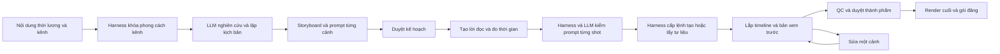

# Đặc tả bộ tạo video hoàn chỉnh từ nội dung

Trạng thái: ĐỀ XUẤT ĐỂ DUYỆT. Tham chiếu: `nghien_cuu_hien_trang_va_phuong_an.md` và master spec ngày 23/10/2026. Các tên hợp đồng/API dưới đây là thiết kế mới, chưa phải tính năng đã có.

Bổ sung bắt buộc phiên bản kế hoạch 2.0 theo yêu cầu Founder: mọi tạo mới/sửa sinh bằng Flow phải qua Harness và LLM; style công ty được khóa theo kênh và run; thi công song song theo owner/hợp đồng đóng băng. Đọc cùng `hop_dong_harness_llm_truoc_flow.md`, `quy_chuan_phong_cach_kenh.md`, `quy_uoc_thi_cong_song_song.md`; các bổ sung này được ưu tiên nếu mô tả cũ chưa đủ chi tiết.

## 1. Kết quả người dùng nhận được

Một nhân sự nội dung nhập content hoặc chủ đề, đặt thời lượng, chọn giọng và kênh, nhận kế hoạch có thể đọc/sửa, sau đó yêu cầu sản xuất. Hệ thống tạo phim đầy đủ hình, lời đọc, nhạc khi được chọn, phụ đề, nhận diện BAHA và xuất gói để đăng. Nhân sự không phải tự nghĩ prompt hoặc tự nối từng clip.

Luồng chính:

Không coi editor là điểm bắt đầu bắt buộc. `/video-studio` trở thành danh sách dự án và hành động “Tạo video từ nội dung”; `/video-studio/[projectId]` mở theo bước đang làm. AI Studio vẫn phục vụ tạo asset riêng, Media Library giữ kho nguồn, editor là chế độ “Chỉnh sửa chi tiết”. Deep link cũ phải còn mở đúng project.

## 2. Hợp đồng đầu vào

`YeuCauTaoVideo`: `noi_dung: str`, `che_do_noi_dung: GIU_NGUYEN_LOI | BIEN_SOAN`, `thoi_luong_giay: int`, `ty_le: str`, `ngon_ngu: str`, `doi_tuong: str`, `muc_tieu: str`, `giong_doc_id: str | null`, `thuong_hieu_phien_ban: str`, `outro: O1 | O2 | O3`, `tu_lieu_ids: list[str]`, `nguon_tham_khao: list[str]`, `nhac_nen: bool`, `ngan_sach_toi_da: decimal | null`.

Backend lấy workspace và user từ xác thực. Khi tạo project trực tiếp, backend tạo liên kết brief/idea thật cần thiết cho ScriptService hiện tại, gắn nguồn “người dùng nhập trực tiếp”; không bắt người dùng đi qua màn hình ý tưởng hoặc tạo IdeaCard giả để lách contract. Không nhận URL/key/provider tùy ý từ client.

Input bổ sung `kenh_id: str | null`, `series_id: str | null`; style công ty không được nhập bằng free text thay quy chuẩn. Nháp có thể chưa chọn kênh; trước sản xuất phải có kênh và binding style đã duyệt. Backend giải quyết style theo kênh, quyền và snapshot; trường `thuong_hieu_phien_ban` phía client chỉ là tham chiếu để kiểm xung đột, không cấp quyền chọn bản chưa duyệt.

Phạm vi pilot đề xuất: 30–180 giây, mặc định 60, bắt buộc 120. Giá trị ngoài phạm vi trả lỗi rõ giới hạn và giữ content. Không rút về mặc định. 9:16 là preset ưu tiên; mở 16:9 ở nhánh mở rộng sau khi kiểm định renderer và safe area riêng. Không quảng bá tỷ lệ chưa chạy thật.

`GIU_NGUYEN_LOI`: không tự rút/chêm nội dung. Nếu giọng tự nhiên không vừa thời lượng thì trả `CHO_XU_LY_THOI_LUONG` kèm thời lượng đo được và lựa chọn sửa lời/đổi thời lượng. `BIEN_SOAN`: cho phép đề xuất rút/mở rộng kịch bản, nhưng phải lưu diff và được duyệt trước sản xuất; không thêm khẳng định thiếu nguồn để lấp thời gian.

## 3. Hợp đồng nội dung và chia cảnh

`KeHoachVideo`: `ke_hoach_id`, `project_id`, `workspace_id`, `phien_ban`, `request_hash`, `script_version_id`, `tong_frame_dich`, `fps_num`, `fps_den`, `research_pack`, `claim_ledger`, `so_tay_lien_tuc`, `canh: list[CanhVideo]`, `uoc_tinh_chi_phi`, `blockers`, `trang_thai_duyet`.

`CanhVideo`: `canh_id` ổn định, `thu_tu`, `loai_canh`, `muc_dich`, `noi_dung_goc_ids`, `claim_ids`, `loi_doc`, `chu_tren_man_hinh`, `frame_bat_dau`, `so_frame`, `voice_asset_id`, `shot: list[ShotVideo]`, `overlay`, `chuyen_canh`, `trang_thai`.

`ShotVideo`: `shot_id`, `canh_id`, `phien_ban`, `prompt`, `prompt_phu_dinh`, `tham_chieu_asset_ids`, `rang_buoc_lien_tuc`, `provider_id`, `model_id`, `capability_version`, `so_frame_su_dung`, `duration_request`, `asset_id`, `provider_operation_id`, `trang_thai`.

Plan/run phải có `khoa_phong_cach: KhoaPhongCach` và Harness session ID. Shot sinh AI phải có `danh_gia_llm_id` và `bien_nhan_harness_id` trước dispatch. Hợp đồng đầy đủ, chữ ký hàm và TTL nằm trong `hop_dong_harness_llm_truoc_flow.md`; chỉ một owner sửa hợp đồng chung để các agent không tự định nghĩa type khác nhau.

Một cảnh kể chuyện có thể gồm nhiều shot, một shot có thể dùng tư liệu có sẵn mà không cần prompt AI. Không cắt content đều theo số ký tự. Planner tách theo luận điểm, nhịp kể, thay đổi minh họa và lời đọc. Mọi ý bắt buộc từ content phải map sang ít nhất một cảnh; đoạn bỏ/rút phải hiện trong diff. Claim quan trọng phải map nguồn và trạng thái. `UNSUPPORTED` và `NEEDS_REVIEW` chặn duyệt nội dung final.

Sổ tay liên tục khóa mô tả nhân vật/vật thể, màu, bối cảnh, phong cách, ảnh chuẩn, hướng chuyển động và từ điển thuật ngữ. Mỗi prompt chỉ mô tả hành động của shot đó; mang đủ ngữ cảnh liên tục và ràng buộc phủ định. Lưu cả prompt chuẩn hóa và prompt gửi adapter, không chỉ giữ một đoạn prompt toàn phim. Mẫu prompt: “Mục tiêu minh họa …; bối cảnh chung …; chủ thể …; hành động riêng của shot …; bố cục dọc …; chuyển động …; không thêm chữ/logo/lời thoại …; khung nối cảnh …”. Văn bản nội bộ và nội dung hiển thị dùng tiếng Việt có dấu.

LLM chạy theo ba bước có JSON schema: dàn ý/claim → lời và cảnh → shot/prompt theo từng nhóm nhỏ. Validate schema, ngân sách token, bao phủ content và tổng frame sau từng bước. JSON bị cắt/malformed trả lỗi; tối đa một lượt sửa cấu trúc theo ngân sách, không âm thầm dùng template giả.

## 4. Thời lượng, lời đọc và phụ đề

1. Chốt mục tiêu thành số frame nguyên. 120 giây ở 30 fps là 3.600 frame; tổng thời lượng toàn phim tính cả hook, khoảng nghỉ và outro.
2. Dự toán lời bằng tốc độ đã hiệu chỉnh trên giọng thật, chỉ để soạn nháp. Đếm từ tiếng Việt không phải phép đo thời lượng cuối.
3. Sinh voice theo segment, có ngữ cảnh trước/sau hoặc phương án voice toàn bài có alignment; đo file thật rồi căn câu/word. Không cắt âm tiết ở ranh scene.
4. Cập nhật thời lượng cảnh theo voice. Sai khác chưa vừa thì điều chỉnh khoảng nghỉ và cảnh không thoại, hoặc đề nghị sửa lời. Tự đổi tốc độ chỉ trong 0,95–1,05 và phải QC giọng; vượt mức thì dừng, không kéo giọng để ép 120 giây.
5. Phân bổ frame bằng lấy phần nguyên rồi phân phối frame dư cho phần thập phân lớn nhất, tie-break theo thứ tự cảnh. Không dùng nhiều lần làm tròn giây gây tích lũy lệch.
6. Cut thẳng là mặc định. Với transition chồng hình, dùng công thức `frame_thanh_pham = tong_frame_clip - tong_frame_chong`; bổ sung handle ngoài phần thời lượng sử dụng. Không trừ hai lần overlap hoặc làm video 120 giây thành 116 giây.
7. Với shot AI, chọn duration nhỏ nhất hợp lệ đáp ứng phần sử dụng cộng handle; nếu vượt tối đa thì tách shot. Ví dụ khi capability thực xác nhận tối đa 8 giây, một cảnh 15 giây có thể dùng 2 shot 8 giây và trim theo ranh nghĩa. Con số này là ví dụ cho capability đó, không phải giới hạn Flow mặc định.
8. Clip thực tế ngắn hơn yêu cầu: dừng/replan/extend nếu được hỗ trợ; không loop clip vô hạn hoặc freeze frame âm thầm. Lặp nhạc chỉ khi cấu hình và quyền cho phép, crossfade và kết thúc tự nhiên.

Phụ đề lấy từ lời đã duyệt và alignment audio thật. Không hiển thị toàn content trên một caption dài toàn phim. Đề xuất pilot: tối đa 2 dòng, tối đa 38 ký tự/dòng nhưng phải đo bounding box thật; tốc độ đọc tối đa 20 ký tự/giây, cue 0,7–6 giây; đoạn không đáp ứng được phải tái chia hoặc tạo issue cần duyệt. Dấu câu/thuật ngữ tiếng Việt giữ nguyên. Sai lệch cue so với câu đọc không quá 200 ms trên mẫu người kiểm; validator tự động chỉ được nhận phạm vi nó đo được.

Safe area 1080 × 1920: mép trên 150 px, dưới 320 px, phải 120 px; thêm lề trái đề xuất 60 px. Kiểm bounding box chữ/logo trong hình chữ nhật này, không chỉ đặt một tọa độ y cố định.

## 5. Ví dụ kế hoạch 120 giây

Chủ đề minh họa: “AI Agent khác Chatbot thông thường như thế nào?”. Đây là storyboard dự kiến để kiểm thiết kế, chưa phải lời thoại đã fact-check hoặc video đã tạo.

| Cảnh | Khoảng thời gian | Loại chính | Mục đích và tư liệu |
|---|---|---|---|
| c01 | 0–3 | TEXT_MOTION | Hook vấn đề cụ thể |
| c02 | 3–13 | DIAGRAM | Khái niệm chatbot, nguồn được map trong claim ledger |
| c03 | 13–23 | DIAGRAM | Khái niệm agent, nêu phạm vi và giới hạn |
| c04 | 23–35 | TEXT_MOTION | So sánh luồng hỏi–đáp và luồng nhiều bước |
| c05 | 35–47 | SCREEN_RECORDING | Minh họa nhiệm vụ tiếp nhận yêu cầu trên công cụ thật |
| c06 | 47–59 | SCREEN_RECORDING | Luồng thực thi có điểm kiểm soát; thiếu recording thì chờ bổ sung |
| c07 | 59–71 | DIAGRAM | Dữ liệu/công cụ/quyền truy cập |
| c08 | 71–83 | AI_VIDEO hoặc REAL_FOOTAGE | Bối cảnh sử dụng, không dùng hình AI làm bằng chứng tính năng |
| c09 | 83–95 | DIAGRAM | Điều kiện và rủi ro cần con người kiểm tra |
| c10 | 95–107 | TEXT_MOTION | Cách chọn theo bài toán, không hứa hiệu quả vô căn cứ |
| c11 | 107–115 | TEXT_MOTION | Tóm tắt giá trị |
| c12 | 115–120 | BRAND_OUTRO | BAHA Group — Cung cấp giải pháp AI toàn diện; O1/O2/O3 theo brief |

Tổng 120 giây, 12 cảnh; số shot sinh AI có thể khác số cảnh. Audio đo thật có thể khiến ranh giới nội bộ thay đổi nhưng tổng frame vẫn khóa 3.600 và phải duyệt lại thay đổi có nghĩa.

## 6. Điều phối, lưu trữ và adapter

Tái sử dụng Next.js, FastAPI, SQLAlchemy, renderer FFmpeg và cấu hình LLM hiện hữu. Không tạo app song song, không thêm microservice/Redis/Celery nếu hàng đợi DB và một worker CPU đáp ứng pilot.

Đề xuất bổ sung ba thực thể bền vững: phiên bản kế hoạch (JSON cấu trúc có CAS), lượt sản xuất, bước sản xuất. Dùng ProductionProject/ScriptDraftVersion/MediaAsset/TimelineVersion/AIGenerationJob/AuditEvent/CostLedger hiện có; không nhân bản asset hoặc timeline. Cần mapping migration cụ thể sau khi G0 xác nhận DB thật. Nếu thay SQL/Postgres phải đọc bộ quy tắc Supabase/Postgres và guardrails RBAC trước khi viết migration.

Run phụ thuộc DAG: nội dung/claim → script → storyboard → duyệt → voice/alignment → chốt timing → assets → assembly → preview/QC → duyệt → render cuối → QC file cuối → export. Research bằng nguồn người dùng hoặc API đã xác minh; tài liệu/web là dữ liệu không tin cậy, không được dùng để đổi hệ thống/key/quyền.

Mọi bước trong DAG chạy trong phiên Harness. Trước `assets` bắt buộc có kiểm LLM theo style đã khóa và receipt Harness cho từng shot; dispatcher duy nhất xác minh receipt rồi mới gọi Flow. Không để API clip cũ, I2V, extend, tạo lại cảnh hay Assisted UI đi vòng. Broker dựng hiện hữu cần được mở rộng qua cổng tạo mới, không mặc định đã có nghiệp vụ này. LLM không khả dụng chuyển `CHO_LLM`; quá vòng sửa style chuyển `CHO_DUYET_PHONG_CACH`, không gửi prompt thô thay thế. Hai trạng thái này bổ sung danh sách trạng thái run ở dưới.

Trạng thái run: `CHO_DUYET_KE_HOACH`, `DANG_SAN_XUAT`, `CHO_TU_LIEU`, `CHO_NHA_CUNG_CAP`, `CHO_XU_LY_THOI_LUONG`, `SAN_SANG_XEM_TRUOC`, `CHO_QC`, `CHO_DUYET_THANH_PHAM`, `DANG_XUAT`, `HOAN_THANH`, `LOI`, `DA_HUY`. State machine hiển thị này map về các trạng thái master spec; `HOAN_THANH` chỉ sau QC file cuối và gói tải đủ, không có nghĩa đã xuất bản.

API dự kiến dùng prefix `/v1/media/projects/{project_id}/tao-video`: POST `/ke-hoach`; GET `/ke-hoach/{id}`; PATCH `/ke-hoach/{id}` với `expected_revision`; POST `/ke-hoach/{id}/duyet`; POST `/luot` với `plan_id`, `revision` và `Idempotency-Key`; GET `/luot/{run_id}`; POST `/luot/{run_id}/huy`; POST `/luot/{run_id}/tiep-tuc`; POST `/canh/{canh_id}/tao-lai`; POST `/luot/{run_id}/duyet-thanh-pham`; POST `/luot/{run_id}/xuat`. Tạo tác vụ trả 202 và resource ID; đọc trả 200; input sai 422; revision/idempotency mismatch 409; thiếu quyền 403; ngoài phạm vi 404. Lệnh duyệt phải lưu người duyệt và hash artifact/revision, không chỉ boolean trên UI.

Mọi bước dùng idempotency fingerprint của workspace, project, plan revision, scene/shot revision, input hash, voice/brand/capability version. Cùng key cùng fingerprint trả kết quả cũ; khác fingerprint trả 409. Worker claim bằng lease giao dịch, heartbeat, TTL, attempt và checkpoint. Khóa provider/Flow và render nặng trên toàn worker, concurrency 1 cho pilot; threading.Lock chỉ trong một process không đủ.

Khi timeout sau submit provider: lưu operation ID, tra trạng thái trước retry. Không biết provider đã nhận hay chưa thì `CHO_NHA_CUNG_CAP`/đối soát, không gửi lại mù. Backoff 2/5/15 giây, tối đa 3 lần chỉ cho lỗi tạm thời xác định an toàn; 401/403/quota/schema dừng đúng lý do. Hủy không tạo side effect tiếp theo; kết quả muộn lưu thành asset không được tự gắn vào run đã hủy.

Registry lưu capability theo product surface, account, model, region, tỷ lệ, duration, ảnh tham chiếu, extension, audio, cancellation, quyền, quota, last_verified và evidence. `REAL_VERIFIED` cần output thật; `REAL_UNVERIFIED`, `PLANNED`, `BLOCKED`, `MOCK` dùng đúng nghĩa. Flow UI, Gemini API và 9Router là ba mặt tích hợp khác nhau. Giọng và ASR chưa có credential phải chặn AUTO đầy đủ; upload voice/recording là đường HYBRID rõ ràng.

Quy chuẩn phong cách có SSOT công ty, binding phiên bản theo kênh, biến thể series trong phạm vi được duyệt và snapshot bất biến trong run. Đổi style/prompt/reference/voice/policy làm vô hiệu đánh giá/approval liên quan. Không dùng `latest` giữa các bước hoặc cho LLM tự đổi từ đồ họa công nghệ sang anime/3D cho video kế tiếp. Palette/font/logo/giọng thật phải được Founder duyệt; style family đầu tiên mới là đề xuất.

## 7. Chỉnh sửa và vô hiệu hóa kết quả

Thay asset một shot chỉ sinh lại shot/cảnh liên quan và bản ghép phụ thuộc; hash tư liệu cảnh khác giữ nguyên. Sửa lời phải tạo script revision, voice/alignment/caption revision; timing và các cảnh downstream có thể cần tính lại. Sửa brand/outro ảnh hưởng đúng overlay/outro. Approval cũ mất hiệu lực khi bất kỳ dependency thuộc artifact được duyệt đổi hash. Giữ bản gốc, revision mới, diff và rollback; không ghi đè bản đã duyệt.

Timeline JSON là dạng editable dùng chung; cần bộ chuyển đổi rõ giữa TimelineDocument hiện hữu và TimelineV2, báo mất dữ liệu/hiệu ứng không hỗ trợ thay vì silently drop. Không hứa NLE roundtrip cho hiệu ứng chưa có adapter.

## 8. QC, đầu ra và UX cần duyệt

File cuối MP4 H.264/yuv420p + AAC, 1080 × 1920, 30 fps; tổng 120 ± 0,5 giây cho ca chính; LUFS tích hợp -14 ± 1, true peak không vượt -1,5 dBTP. Full decode không lỗi. Phát kiểm toàn video, không chỉ xem thumbnail. Audio có lời và không cắt câu; nhạc không che lời. Không scene trống/asset giả/cảnh lặp để đủ phút; kiểm tra đóng băng có danh sách cho phép cho đồ họa tĩnh.

Gói xuất gồm MP4, SRT UTF-8, thumbnail, kịch bản có nguồn, storyboard, prompt từng shot, timeline editable, manifest/hash, QC report, usage/cost và caption/description/hashtag cho kênh. Không yêu cầu file nội bộ chứa token/cookie/profile. Gói đăng thủ công là đầu ra sử dụng được; chỉ đánh dấu published khi có external confirmation qua tích hợp đã cấp quyền.

Prototype bắt buộc trước backend nặng: (1) form nhập content/thời lượng/chế độ lời, (2) kịch bản và cảnh/prompt/tổng thời gian/chi phí/blocker, (3) tiến độ từng bước có tiếp tục/hủy, (4) player với QC/timecode và sửa cảnh, (5) gói tải. Có mẫu 60 giây và 120 giây; lỗi nội dung quá dài, Flow hết phiên, thiếu voice, hết quota, xung đột revision, chưa có recording phải nhìn được. Founder duyệt prototype và storyboard mẫu ở G1 trước G2–G6. Phiên này cung cấp thiết kế, chưa tuyên bố có prototype đã duyệt.
