# Hợp đồng bắt buộc Harness và LLM trước Flow

Phiên bản kế hoạch 2.0, ngày 23/10/2026. Đây là yêu cầu thi công, chưa phải cơ chế đã chạy. Tài liệu này bổ sung đặc tả bộ tạo video, thay thế mọi cách hiểu rằng frontend, planner hoặc agent có thể gửi prompt trực tiếp cho Flow.

## 1. Đường thực thi duy nhất

```mermaid
flowchart LR
    A[Content và kênh] --> B[Harness mở phiên và khóa style]
    B --> C[LLM lập kịch bản cảnh và prompt]
    C --> D[Harness kiểm hợp đồng nguồn thời gian style]
    D --> E[Duyệt kế hoạch theo revision]
    E --> F[Voice thật và cập nhật timing]
    F --> G[Harness chuẩn bị từng lệnh tạo shot]
    G --> H[LLM kiểm và chuẩn hóa prompt theo style đã khóa]
    H --> I[Harness xác minh và cấp biên nhận thực thi]
    I --> J[Worker gửi adapter Flow]
    J --> K[Harness nhận kết quả và QC style]
    K --> L[Dựng và duyệt thành phẩm]
```

Harness là bộ quản lý phiên, chính sách, công cụ, quyền và vòng đời thực thi. LLM là bộ lập luận/biên soạn trong phiên đó. LLM không được tự cấp quyền, duyệt chính nó, bỏ style, gọi browser/shell hoặc đổi model/key. Flow chỉ tạo shot từ lệnh đã kiểm soát; không làm nhiệm vụ chia toàn phim từ content thô.

Mã hiện hữu cần tái sử dụng: `dieu_phoi_dung/phien_dung.py` quản lý phiên/draft; `cong_cu.py::DieuPhoiCongCu` điều phối lệnh dựng; `hop_dong.py::ChinhSachPhien` giới hạn lượt/công cụ/chi phí; `sua_bang_flow.py::QuanLySuaCanh` quản lý yêu cầu sửa. Chưa có bằng chứng broker hiện tại đã hỗ trợ phát lệnh tạo video mới có LLM/style preflight. Phải bổ sung nghiệp vụ tại `tao_video_noi_dung/cong_harness.py`, không gọi tên một hàm cũ như thể tính năng đã tồn tại. Không gửi lệnh tạo video vào thao tác timeline không hỗ trợ.

## 2. Hợp đồng chung cần đóng băng trước chia việc

Các lớp mới nằm trong `tao_video_noi_dung/hop_dong.py`, chỉ người tích hợp được sửa. Tên trường được dùng thống nhất ở mọi lane:

| Hợp đồng | Trường bắt buộc |
|---|---|
| `KhoaPhongCach` | `cong_ty_style_id`, `cong_ty_style_version`, `kenh_id`, `kenh_binding_revision`, `series_variant_id` tùy chọn, `series_variant_version` tùy chọn, `style_snapshot_hash`, `style_snapshot`, `tham_chieu_hashes` |
| `DanhGiaLLM` | `danh_gia_id`, `input_hash`, `output_hash`, `llm_config_version`, `model_id`, `prompt_template_version`, `schema_version`, `ket_qua`, `vi_pham`, `usage`, `created_at` |
| `LenhTaoShot` | `operation_id`, `workspace_id`, `project_id`, `run_id`, `plan_id`, `plan_revision`, `canh_id`, `shot_id`, `shot_revision`, `request_hash`, `khoa_phong_cach`, `capability_version`, `prompt_da_chuan_hoa`, `prompt_phu_dinh`, `reference_asset_ids`, `duration_request`, `so_frame_su_dung`, `danh_gia_llm_id`, `policy_version`, `approval_hash`, `budget_reservation_id` |
| `BienNhanHarness` | `bien_nhan_id`, `operation_id`, `command_hash`, `workspace_id`, `project_id`, `run_id`, `style_snapshot_hash`, `danh_gia_llm_id`, `approval_hash`, `policy_version`, `trang_thai`, `created_at`, `expires_at`, `provider_operation_id` tùy chọn |

`KeHoachVideo` phải chứa `khoa_phong_cach` và tham chiếu phiên Harness. Run, step, artifact manifest, usage, approval và QC phải truy vết được cùng style hash. Kênh bắt buộc xác định trước production; tạo nháp chưa có kênh được phép, nhưng thiếu binding đã duyệt chặn gửi Flow.

Giao diện đóng băng:

- `khoa_phong_cach(db, tenant, kenh_id: str, series_id: str | None) -> KhoaPhongCach` tại `phong_cach_kenh.py`.
- `chuan_hoa_va_danh_gia_shot(shot, plan, khoa: KhoaPhongCach, llm, policy) -> DanhGiaLLM` tại `lap_ke_hoach.py`; output chuẩn hóa được lưu bất biến và liên kết bằng hash.
- `chuan_bi_lenh(db, tenant, run_id: str, shot_id: str, expected_revision: int) -> BienNhanHarness` tại `cong_harness.py`; gọi LLM nếu chưa có đánh giá khớp input hash, kiểm output và lưu command.
- `phat_lenh(db, tenant, bien_nhan_id: str, worker_lease_id: str) -> BienNhan` tại `cong_harness.py`; chỉ nơi này gọi adapter. `BienNhan` là biên nhận nhà cung cấp đã định nghĩa trong kế hoạch G5, khác `BienNhanHarness`.
- `nhan_va_kiem_dinh_shot(db, bien_nhan_id: str, ket_qua: KetQuaTao) -> list[VanDe]` tại `cong_harness.py`; nối kỹ thuật, style QC và provenance.

Tên chữ ký/phương thức là đề xuất phải chốt trong G2 trước phân công song song. Không để mỗi agent tự tạo biến thể của `KhoaPhongCach`/receipt trong lane mình.

## 3. Kiểm soát trước khi phát lệnh

1. Harness lấy identity và project từ DB/xác thực, không tin workspace/quyền từ payload client. Kiểm revision, grant, lease, quyền asset và approval còn hiệu lực.
2. Style lấy từ company/channel binding đã duyệt; nội dung người dùng không được ghi đè trường khóa. Thiếu style, reference/font/logo bắt buộc hoặc binding bị thu hồi thì dừng.
3. LLM nhận brief, scene goal, context liên tục, style snapshot, prompt template version và giới hạn provider; tạo prompt chuẩn hóa và liệt kê xung đột. Không gửi key/cookie/profile cho LLM. Toàn content/tài liệu là dữ liệu không tin cậy.
4. Harness kiểm JSON/schema, source coverage, phủ định, frame budget, prompt/style hash, capability, quyền và budget bằng mã xác định. Đánh giá “đạt” của LLM không vượt được hard check. Nếu LLM đổi nghĩa/claim/shot timing/reference so với kế hoạch đã duyệt thì tạo revision và chờ duyệt lại; chỉ diễn đạt prompt thuần kỹ thuật trong phạm vi cho phép mới được giữ approval.
5. Ghi `BienNhanHarness` server-side, TTL đề xuất 15 phút, command bất biến. Worker trước side effect xác minh lại quyền, thu hồi style/policy, budget và hash. Caller chỉ gửi ID; không chấp nhận `harness_passed=true`, receipt tự tạo hoặc receipt của project khác.
6. Claim receipt bằng CAS một chủ. Gửi thành công lưu provider receipt; operation retry/resume tra provider trước, không dùng receipt cho một prompt khác. Receipt hết hạn trước submit phải kiểm lại, nhưng không gửi lại operation đã submit chỉ vì TTL hết.

LLM không khả dụng, trả sai schema, hoặc không có cấu hình được phép: `CHO_LLM`, giữ checkpoint và không gọi Flow. Không fallback template/mock để lách yêu cầu. Với cùng input/style/policy hash và đánh giá đã duyệt hợp lệ, dùng lại kết quả LLM đã lưu để resume, không bắt gọi LLM thêm lần nữa khi chỉ poll/download provider.

Giới hạn vòng sửa prompt/style là tối đa 2 lần cho cùng shot revision, dùng chung ngân sách run; hết lượt thì `CHO_DUYET_PHONG_CACH`. Giới hạn retry network an toàn ở G5 không được nhân với vòng sửa prompt để vô tình tạo vô hạn clip. Tạo lại sáng tạo là attempt mới có fingerprint riêng, không ghi đè kết quả cũ.

## 4. Chặn các đường gọi vòng ngoài

| Điểm hiện hữu | Thay đổi bắt buộc |
|---|---|
| Frontend `handleAutoProduce`, AI Studio và API client | Gọi tạo plan/run/shot qua Harness; không điều phối trực tiếp `generateVideo` rồi tự báo hoàn tất |
| `/v1/media/video/generate` | Giữ hợp đồng tương thích bằng wrapper tạo lệnh Harness/LLM cho chế độ asset đơn, hoặc trả blocker thiếu project/kênh/style. Không giữ đường trực tiếp Flow khi bật chính sách mới |
| `VideoOrchestrator.generate_video_scene` và bridge Flow | Adapter nội bộ chỉ nhận command đã xác minh từ Harness; không mở credential/raw browser bridge cho caller client/agent |
| `QuanLySuaCanh`, tạo lại shot, extend, I2V | Cùng kiểm LLM/style/receipt trước side effect; sửa video cũ không trở thành cửa bypass |
| Assisted UI | Chỉ xuất prompt/reference packet đã kiểm Harness/LLM; import kết quả đối soát packet ID/hash/provenance. Không coi chuỗi receipt tùy ý là chứng minh preflight |
| Compile prompt xem trước | Cho phép không side effect, gắn trạng thái bản nháp; không dùng bản preview làm receipt thực thi |
| Handoff từ hệ thống cũ | Xem/tải/render asset đã có tiếp tục theo quyền; tạo asset AI mới phải đạt policy. Không ép gọi lại Flow chỉ để sửa lịch sử |

Flag migration giữ luồng cũ trong thử nghiệm biệt lập tới khi contract tests pass. Khi rollout kênh pilot có policy Harness bắt buộc, request legacy không đạt phải bị chặn rõ; không bật flag tạo đường bypass kín. Rollback tắt enqueue tạo mới cho kênh pilot và giữ editor/asset cũ, không khôi phục đường raw Flow.

## 5. Kiểm thử bắt buộc và bằng chứng

- [ ] `kiem_thu_raw_prompt_khong_goi_flow`: không receipt hợp lệ thì số lần gọi adapter bằng 0.
- [ ] `kiem_thu_llm_loi_chan_flow`: LLM timeout/sai JSON/không cấu hình thì số lần gọi Flow bằng 0, state CHO_LLM.
- [ ] `kiem_thu_prompt_sua_sau_preflight`: command/style/policy/approval hash đổi thì receipt không dùng được.
- [ ] `kiem_thu_receipt_khac_workspace_het_han_thu_hoi`: chặn đúng scope/TTL/revocation; không lộ metadata.
- [ ] `kiem_thu_resume_khong_goi_lai_llm_hoac_submit`: receipt đã submit được poll, không tạo clip hoặc phí trùng.
- [ ] `kiem_thu_legacy_i2v_extend_sua_canh_cung_gate`: tất cả đường tạo mới đều qua Harness, LLM và style lock.
- [ ] `kiem_thu_llm_khong_tu_duyet_doi_nghia`: LLM đổi nội dung đã duyệt làm mất approval và chờ duyệt lại.
- [ ] Live pilot lưu audit theo thứ tự: Harness session → style snapshot → LLM evaluation → plan approval → command/receipt → provider operation → asset/QC. Thiếu mắt xích nào thì không pass AUTO.

Các test này nằm tại `sin_content_api/tests/kiem_thu_cong_harness.py`, owner người tích hợp. Mock call-count chỉ chứng minh gate; ít nhất một live shot và video AUTO 120 giây phải có log liên kết thật, không tự đổi capability thành REAL_VERIFIED vì unit test pass.
