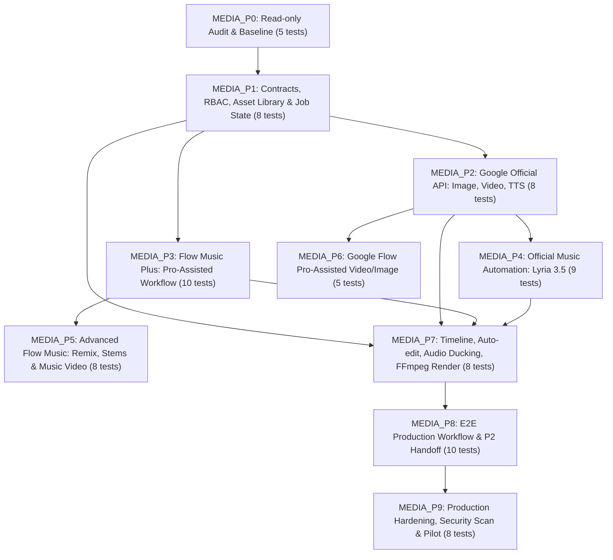

# KẾ HOẠCH TÍCH HỢP VÀ ĐIỀU CHỈNH HỆ THỐNG BAHA AI MEDIA STUDIO VÀO THỰC TẾ DỰ ÁN PRJ_069

- **Mã kế hoạch**: BAHA-MEDIA-STUDIO-001
- **Phiên bản kế hoạch**: 1.0.0
- **Ngày thiết lập cơ sở**: 2026-10-22
- **Tình trạng thực thi**: ĐÃ TIẾP NHẬN & QUY HOẠCH KIẾN TRÚC (CHƯA VIẾT MÃ TÍNH NĂNG - CHƯA CODE)
- **Gói nguồn gốc**: `01_nguon_goc_bat_bien/BAHA_AI_Media_Studio_Implementation_Pack_v1.zip`
- **Mã băm SHA256 nguyên bản**: `5A87EB7B94638B8321F35E82058906CB6DD61E64894686D2E54C5AB275F58B49`
- **Thư mục đối soát diff nguyên mẫu**: `02_nguyen_ban_giai_nen/baha_ai_media_studio_pack/`
- **Technical SSOT thực thi**: `03_ban_lam_viec/`
- **Kiến trúc sư hệ thống**: Antigravity (Architect & Orchestrator)

---

## 1. BỐI CẢNH VÀ MỤC TIÊU TÍCH HỢP

### 1.1. Bối cảnh dự án PRJ_069
Dự án PRJ_069 là Hệ thống sáng tạo và xây dựng kênh TikTok chuyên nghiệp cho Sin (BAHA Group). Hệ thống hiện đã xây dựng xong:
1. **Frontend SaaS (`03_ban_lam_viec/sin_creator_os/`)**: Next.js 16+, Tailwind CSS v4, bộ nhận diện thương hiệu BAHA Creator Studio, bao gồm các màn hình khung: `/dashboard`, `/discover`, `/ideas`, `/scripts`, `/ai-studio`, `/video-studio/[projectId]`, `/content`, `/publishing`, `/media`, `/analytics`, `/settings`. Đạt chuẩn 100% SVG Vector (không có emoji).
2. **Backend Content Intelligence (`03_ban_lam_viec/sin_content_api/`)**: FastAPI, Pydantic v2, SQLAlchemy ORM, SQLite offline / PostgreSQL plans, đã quy hoạch và kiểm thử các pha P00 đến P12 (Brand Brief, Ingestion, Query Planner, NLP Understanding, Retrieval Scorer, Ideation Generator, Script Drafting & Fact-Checking, Feedback Loop, Staging/Evaluation).
3. **Hệ thống phân quyền Doanh nghiệp (`03_ban_lam_viec/baha_auth/`)**: Khung phân quyền đa khách thuê (Multi-tenant), cách ly dữ liệu theo `workspace_id`, cơ chế Bốn Mắt (Four-Eyes Principle / No Self-Approval), danh mục 58 action keys và 15 vai trò tổ chức.

### 1.2. Mục tiêu của Gói BAHA AI Media Studio (P1 Production)
Gói `BAHA_AI_Media_Studio_Implementation_Pack_v1` bổ sung chuỗi sản xuất media (P1 Production Workflow) vào PRJ_069 nhằm hiện thực hóa luồng:
- Chuyển đổi từ Kịch bản đã duyệt (`APPROVED Script`) sang Kế hoạch sản xuất (`Production Project & Tasks`).
- Tích hợp các mô hình AI tạo media của Google (Ảnh, Video B-roll, Giọng đọc TTS, Nhạc nền AI Lyria 3.5).
- Tích hợp quy trình trợ lý Pro (`SUBSCRIPTION_ASSISTED`) với Google Flow và Flow Music Plus thông qua thao tác người dùng chính thức và nhập tư liệu có lưu vết xuất xứ (provenance).
- Xây dựng trình dựng video và trộn âm thanh đa rãnh (Timeline Editor, Audio ducking, Subtitle Safe Zone TikTok, FFmpeg render).
- Thiết lập quy trình kiểm định chất lượng (QC), rà soát bản quyền (Rights Gate) và phê duyệt 2 bước trước khi bàn giao cho luồng xuất bản (P2 Handoff).

---

## 2. NGUYÊN TẮC BẤT BIẾN VÀ RANH GIỚI KHÔNG ĐƯỢC ĐÁNH TRÁO

Hệ thống tuân thủ nghiêm ngặt 5 ranh giới công nghệ cốt lõi:

1. **GROUND TRUTH > SELF-REPORT (BẰNG CHỨNG THỰC TẾ TRÊN HẾT)**:
   - Tuyệt đối không tự suy đoán hoặc báo cáo PASS khi chưa có lệnh chạy thực tế, mã thoát 0, và tệp bằng chứng với mã băm SHA256 chính xác.
   - Không dùng mock/fake test để thay thế cho năng lực thật của nhà cung cấp.

2. **BA LUỒNG NHÀ CUNG CẤP TÁCH BIỆT RẠCH RÒI**:
   - **`SUBSCRIPTION_ASSISTED` (Google AI Pro / Flow Music Plus / Google Flow)**:
     + Nhân viên sử dụng tài khoản cá nhân/công ty thao tác trên giao diện chính thức (`flowmusic.app` hoặc `labs.google/fx/tools/flow`).
     + Hệ thống BAHA chỉ hỗ trợ: Sinh Music Brief / Video Prompt, sao chép prompt, cung cấp liên kết mở web, và bộ nhập tệp (Import uploader) tiếp nhận MP3/WAV/M4A/Stems ZIP/MP4 do người dùng tải về.
     + Trích xuất siêu dữ liệu, tính SHA256, chạy ffprobe, và ghi nhận lưu vết xuất xứ (`provenance`).
     + **Tuyệt đối KHÔNG có cơ chế tự động gọi API ngầm hoặc cào dữ liệu qua cookie/JWT của người dùng**.
   - **`OFFICIAL_API` (Google GenAI Official Developer API)**:
     + Backend BAHA gọi chính thức qua SDK `@google/genai` (Node.js) hoặc `google-genai` (Python) hoặc REST endpoints.
     + Sử dụng API key chính thức của dự án Google Cloud có cấu hình thanh toán (billing) và hạn ngạch (quota) riêng biệt.
     + Chi phí tính toán qua sổ cái `usage_ledger`. Tín dụng này hoàn toàn tách biệt, **không tiêu hao tín dụng Google AI Pro consumer**.
     + Các mô hình chính thức: Tạo nhạc tự động `lyria-3.5` (qua Gemini Interactions API), Tạo ảnh `gemini-nano-banana-2.1`, Tạo video ngắn `gemini-omni-1.1-flash`, Tổng hợp giọng nói `gemini-3.8-flash-tts`.
   - **`UNOFFICIAL_RESEARCH` (Các kho mã nguồn bên thứ ba)**:
     + Bao gồm: `south1907/flowmusic-toolkit`, `Skquark/FlowMusicApp-Toolkit`, `nuan-cmyk/flowmusic-api`, `useapi/flowmusic-api`, `ffroliva/gflow-cli`, `eddie-fqh/flow-py`.
     + **Trạng thái bắt buộc**: `RESEARCH_ONLY` và **mặc định vô hiệu hóa (`DISABLED`) trong môi trường Production**.
     + Tuyệt đối không nhúng token web nội bộ (`/__api/...`), không yêu cầu JWT người dùng, không né CAPTCHA.

3. **BẢO VỆ BẢN QUYỀN VÀ QUYỀN GIỌNG NÓI (RIGHTS & CONSENT GATE)**:
   - Nhân bản giọng nói (Voice replication) bắt buộc phải có tệp âm thanh chấp thuận rõ ràng của chính chủ trưởng thành (`voice_consent`), lưu trữ hợp đồng/chứng từ; nếu thiếu, tính năng bị khóa (`DISABLED`).
   - Nhạc nền và tư liệu B-roll bắt buộc có bản ghi cấp phép (`asset_license`); nếu bản quyền bị thu hồi, hệ thống chặn xuất bản (`RIGHTS_BLOCK`).

4. **TUYỆT ĐỐI KHÔNG DÙNG ICON / EMOJI - 100% SVG VECTOR**:
   - Không xuất hiện bất kỳ ký tự emoji hay unicode icon nào trong UI, mã nguồn, kịch bản, log terminal, báo cáo và tên tệp. Toàn bộ biểu tượng trực quan dùng SVG chuẩn (Lucide SVG / inline `<svg>`).

5. **KIỂM SOÁT TÀI NGUYÊN VÀ PHẦN CỨNG NAS/WINDOWS**:
   - Các tác vụ nặng (FFmpeg render, Whisper ASR, AI generation worker): Giới hạn Concurrency = 1 để tránh tràn VRAM GPU và nghẽn băng thông ổ đĩa mạng NAS.

---

## 3. ĐIỀU CHỈNH KẾ HOẠCH VÀO THỰC TẾ DỰ ÁN PRJ_069

Để tích hợp gói kế hoạch vào thực tế mà không gây xung đột với mã nguồn và các phân hệ hiện có, các điểm điều chỉnh sau được áp dụng:

### 3.1. Chuẩn hóa định danh Pha và Mã kiểm thử (Namespace Mapping)
- Trong PRJ_069, phân hệ Content Intelligence đã sử dụng tiền tố `P00` đến `P14`, và phân hệ RBAC đã sử dụng `A00` đến `A12`.
- Gói Media Studio gốc dùng `P0` đến `P9` và các bài test `A01-A05`, `B01-B08`,... Điều này gây nhầm lẫn nghiêm trọng khi đối soát.
- **Quy chuẩn điều chỉnh**:
  + Định danh pha Media Studio: `MEDIA_P0` đến `MEDIA_P9` (viết tắt: `M-P0` đến `M-P9`).
  + Mã kiểm thử nội bộ: `MED-A01` đến `MED-J08` (tổng số 79 bài test).
  + Khi chạy công cụ xác thực `scripts/verify_evidence.py`, hệ thống ánh xạ 1:1 sang tên gốc (`P0` -> `P9`, `A01` -> `J08`) để bảo đảm tính tương thích với JSON Schema `acceptance-index.json`.

### 3.2. Ánh xạ vào giao diện Frontend hiện có (`03_ban_lam_viec/sin_creator_os/`)
Không tạo giao diện rời rạc, mà tích hợp trực tiếp vào cấu trúc route sẵn có của BAHA Creator Studio:
- **Trang `/ai-studio`**:
  + Tab **Flow Music Pro-Assisted** (tương ứng `MEDIA_P3` & `MEDIA_P5`): Bộ tạo Music Brief, prompt builder kèm nút sao chép, link mở Flow Music, khu vực kéo thả nhập MP3/WAV/Stems ZIP, hiển thị dạng sóng (waveform), phát nghe thử 2 bản (audition AB).
  + Tab **Official Lyria Music** (tương ứng `MEDIA_P4`): Giao diện tạo nhạc tự động qua Interactions API, chọn thể loại/mood, hiển thị chi phí dự kiến ($0.08) và trừ vào hạn mức API billing.
  + Tab **Google Image & Video** (tương ứng `MEDIA_P2` & `MEDIA_P6`): Tạo ảnh bằng Gemini Nano Banana 2.1, tạo video B-roll 3-10s bằng Gemini Omni Flash.
  + Tab **Voice & TTS** (tương ứng `MEDIA_P2`): Tổng hợp giọng đọc tiếng Việt bằng Gemini 3.8 Flash TTS, quản lý tệp ghi âm chấp thuận giọng nói (`voice_consent`).
  + Bảng điều khiển tín dụng: Tách bạch rõ số dư API Billing thật và trạng thái `MANUAL_VERIFIED` / `UNKNOWN` của Flow Music Credits (tuyệt đối không bịa số dư).
- **Trang `/video-studio/[projectId]`**:
  + Không gian dựng video dọc TikTok 9:16 (1080 x 1920 px) (tương ứng `MEDIA_P7`).
  + Hiển thị khung an toàn (TikTok Safe Zone Overlay: mép trên 150px, mép dưới 320px, mép phải 120px) để canh chỉnh phụ đề và visual cues.
  + Multi-track timeline (Video, B-roll, Voice, Music, Subtitles) với tính năng Auto-ducking (nhạc tự hạ âm lượng khi có giọng thoại).
- **Trang `/content` (Kanban Pipeline)**:
  + Tích hợp cột `Production` và `Review` kết nối trực tiếp với các project dựng phim (tương ứng `MEDIA_P8`).

### 3.3. Ánh xạ vào Backend Service Layer (`03_ban_lam_viec/sin_content_api/`)
Tổ chức phân hệ backend theo cấu trúc module độc lập trong SSOT:
- Thư mục backend: `03_ban_lam_viec/sin_content_api/media_studio/` (hoặc routers tương ứng trong `sin_content_api/api/v1/`).
- Thực thể CSDL (ORM Models):
  1. `production_projects`: Dự án dựng video gắn với kịch bản `script_id` và workspace `org_id`.
  2. `production_tasks`: Nhiệm vụ phân cảnh (shot list, voiceover, b-roll, audio).
  3. `media_assets`: Quản lý tập trung mọi asset (video, audio, stems, image), lưu trữ `storage_key`, `sha256`, `byte_size`, `mime_detected`, `duration_ms`, `source_product`, `license_record_id`.
  4. `ai_generation_jobs`: Quản lý hàng đợi job sinh media AI, lưu `idempotency_key`, `provider`, `model_id`, `state` (`DRAFT`, `QUEUED`, `RUNNING`, `SUCCEEDED`, `FAILED`, `CANCELLED`), `estimated_cost`, `actual_cost`, `credits_source`.
  5. `music_briefs`: Bản tóm tắt yêu cầu nhạc (mood, genre, BPM, vocal language, duration).
  6. `timeline_versions`: Lịch sử các phiên bản timeline JSON bất biến.
  7. `voice_consents`: Bản ghi xác thực quyền sử dụng giọng nói người thật.
  8. `qc_results` & `approval_decisions`: Bản ghi thẩm định chất lượng và phê duyệt 2 bước.
- Kho lưu trữ tệp:
  + Môi trường phát triển cục bộ: NAS path `03_ban_lam_viec/media_assets/` tổ chức theo cấu trúc `org_{id}/project_{id}/assets/`.
  + Môi trường Production: S3 / Cloudflare R2 với presigned URL có thời hạn (TTL ngắn) và kiểm tra mã băm SHA256.

### 3.4. Tích hợp ma trận phân quyền Doanh nghiệp (`baha_auth`)
Kế thừa hoàn toàn hệ thống phân quyền của dự án, bổ sung các quyền hành động mới thuộc phạm vi Media Studio:

| Action Key | Ý Nghĩa Nghiệp Vụ | Vai Trò Cho Phép |
|---|---|---|
| `media.upload` | Tải lên tư liệu thô, nhạc, ảnh, stems | Member, Editor, Creator, Admin |
| `media.read` | Xem và tải về tư liệu truyền thông | Viewer (cùng org), Editor, Admin |
| `media.delete` | Xóa tư liệu chưa khóa trong dự án | Editor (chủ tạo), Admin |
| `ai_job.create` | Gửi yêu cầu sinh ảnh/video/nhạc AI | Editor, Creator, Admin |
| `ai_job.cancel` | Hủy yêu cầu sinh media đang chờ | Editor (chủ tạo), Admin |
| `music_brief.create` | Soạn thảo Music Brief cho Flow/Lyria | Editor, Creator, Admin |
| `timeline.edit` | Chỉnh sửa timeline video đa rãnh | Editor, Creator, Admin |
| `timeline.render` | Kích hoạt worker render video MP4 | Editor, Creator, Admin |
| `production.review` | Thực hiện kiểm định QC và ghi chú timecode | Reviewer, Editor, Content Lead |
| `production.approve_final` | Phê duyệt bản dựng hoàn chỉnh (PUBLISH_READY) | Content Lead, Admin, Owner |

**Nguyên tắc Bốn Mắt (Four-Eyes Principle)**: Editor trực tiếp dựng phim không được phép tự phê duyệt bản dựng của chính mình (`production.approve_final`); bắt buộc phải có Content Lead hoặc Reviewer độc lập ký duyệt.

### 3.5. Bộ điều chỉnh công cụ kiểm tra bằng chứng (Windows Runtime Adapter)
- Gói gốc cung cấp `scripts/verify_evidence.py` và `test_verify_evidence.py`.
- Khi chạy trên Windows Server, lệnh `python3` trong subprocess gây lỗi mã thoát 9009 do cơ chế Microsoft Store alias.
- Hệ thống điều chỉnh script thực thi tại `03_ban_lam_viec/cong_cu_tu_dong/kiem_tra_bang_chung_media.py` sử dụng `sys.executable` và đường dẫn chuẩn hóa `pathlib.Path`, bảo đảm chạy ổn định 100% trên Windows và NAS mà không phụ thuộc vào hệ điều hành.

---

## 4. CHI TIẾT 10 PHA TRIỂN KHAI VÀ MA TRẬN 79 BÀI TEST

Dự án chia thành 10 pha tuần tự có cổng nghiệm thu (Phase Gates). Mỗi bài kiểm thử được phân định rõ 1 trong 4 cấp độ bằng chứng:
- **`DOC_VERIFIED`**: Tài liệu chính thức của nhà cung cấp hoặc mã nguồn repo được đối soát.
- **`LOCAL_TESTED`**: Lệnh chạy cục bộ trên máy chủ dự án, có log thực tế và mã thoát 0.
- **`LIVE_VERIFIED`**: Lệnh gọi thực tế đến API nhà cung cấp với API key/billing thật, có request_id và tệp media sinh ra thật kèm SHA256. (Nếu chưa cấp key -> Báo cáo `BLOCKED_CREDENTIALS`).
- **`HUMAN_VERIFIED`**: Phiếu đánh giá có chữ ký của chuyên gia / QA / Founder được phân quyền.

### Tổng hợp 10 Pha:

| Pha | Tên Pha Triển Khai | Số Bài Test | Test IDs Ánh Xạ | Trọng Tâm Nghiệm Thu |
|---|---|:---:|:---:|---|
| **MEDIA_P0** | Khảo sát tĩnh, kiểm kê repo & ranh giới pháp lý | 5 | MED-A01 đến MED-A05 | Xác nhận commit gốc, baseline test suite, audit 5 repo bên thứ ba, rà soát điều khoản Google. |
| **MEDIA_P1** | Hợp đồng DTO, RBAC, Thư viện tư liệu & Máy trạng thái Job | 8 | MED-B01 đến MED-B08 | Di trú CSDL an toàn, cách ly đa tenant, tính lũy đẳng (idempotency), kiểm tra file độc hại (zip bomb/traversal), ffprobe. |
| **MEDIA_P2** | Nền tảng Google Official API: Image / Video / TTS | 8 | MED-C01 đến MED-C08 | Tích hợp `@google/genai` / `google-genai`, kiểm tra model list thật, Gemini Image/Video/TTS, chặn nhân bản giọng thiếu consent. |
| **MEDIA_P3** | Flow Music Plus: Trải nghiệm Pro-Assisted | 10 | MED-D01 đến MED-D10 | Music Brief Builder, prompt copy, bộ nhập file MP3/WAV/Stems ZIP, chống file giả mạo, dedup, hiển thị waveform. |
| **MEDIA_P4** | Tạo nhạc tự động chính thức: Lyria 3.5 | 9 | MED-E01 đến MED-E09 | Interactions API `lyria-3.5` ($0.08/track), clip preview, nhạc từ text/image, QC lời Việt thực tế, tách bạch chi phí API vs Pro. |
| **MEDIA_P5** | Flow Music nâng cao: Remix, Stems, Music Video | 8 | MED-F01 đến MED-F08 | Quy trình chỉnh sửa thủ công (remix, extend, stem split), bảo toàn chuỗi phả hệ asset (parent-child lineage), kiểm định repo toolkits. |
| **MEDIA_P6** | Google Flow Pro-Assisted: Video & Hình ảnh | 5 | MED-G01 đến MED-G05 | Handoff prompt sang Google Flow, nhập tệp MP4/PNG, bảo toàn watermark hiển thị/SynthID, ghi nhận xuất xứ. |
| **MEDIA_P7** | Dựng phim đa rãnh, Auto-ducking & FFmpeg Render | 8 | MED-H01 đến MED-H08 | Timeline JSON đa rãnh, tự động hạ nhạc nền khi có lời thoại (ducking), canh subtitle vào TikTok Safe Zone, render chuẩn dọc 9:16. |
| **MEDIA_P8** | Chuỗi sản xuất E2E & Bàn giao luồng xuất bản (P2) | 10 | MED-I01 đến MED-I10 | Luồng hoàn chỉnh Idea -> Script -> Task -> Footage -> Timeline -> QC -> Approval -> Export, chặn tự duyệt (Four-Eyes), khóa hash bản duyệt. |
| **MEDIA_P9** | Tối ưu an ninh, khả năng chịu tải & Vận hành thử nghiệm | 8 | MED-J01 đến MED-J08 | Quét secret không rò rỉ, tải giả lập hàng đợi, sao lưu khôi phục CSDL, kiểm soát trần ngân sách, ký duyệt Go/No-Go. |

---

## 5. BẢNG THEO DÕI TRẠNG THÁI HIỆN TẠI (CURRENT VERIFICATION STATUS)

| Pha Triển Khai | Số Test | DOC | LOCAL | LIVE | HUMAN | Trạng Thái Hiện Tại | Ghi Chú Ranh Giới Thực Tế |
|---|:---:|:---:|:---:|:---:|:---:|:---:|---|
| **MEDIA_P0** | 5 | 2 | 1 | 0 | 2 | **NOT_STARTED** | Chưa chạy baseline command; sẵn sàng thực thi khảo sát khi có lệnh. |
| **MEDIA_P1** | 8 | 0 | 8 | 0 | 0 | **NOT_STARTED** | Chưa tạo bảng CSDL mới; chưa viết code provider. |
| **MEDIA_P2** | 8 | 0 | 4 | 4 | 0 | **NOT_STARTED** | Chưa cấp API key / billing Google Cloud. Test LIVE mặc định `BLOCKED_CREDENTIALS`. |
| **MEDIA_P3** | 10 | 0 | 6 | 3 | 1 | **NOT_STARTED** | Cần tài khoản Google AI Pro thật của nhân viên để nhập 3 bài nhạc thật. |
| **MEDIA_P4** | 9 | 0 | 3 | 5 | 1 | **NOT_STARTED** | Cần quyền truy cập Google Lyria 3.5 API. Test LIVE mặc định `BLOCKED_CREDENTIALS`. |
| **MEDIA_P5** | 8 | 1 | 4 | 0 | 3 | **NOT_STARTED** | Cần thao tác thủ công trên Flow Music UI của người dùng. |
| **MEDIA_P6** | 5 | 1 | 1 | 1 | 2 | **NOT_STARTED** | Cần tài khoản Google Flow Pro. |
| **MEDIA_P7** | 8 | 0 | 7 | 0 | 1 | **NOT_STARTED** | Cần cài đặt FFmpeg/FFprobe trên môi trường máy chủ. |
| **MEDIA_P8** | 10 | 0 | 9 | 0 | 1 | **NOT_STARTED** | Chờ tích hợp đầy đủ các pha thành phần. |
| **MEDIA_P9** | 8 | 0 | 6 | 0 | 2 | **NOT_STARTED** | Pha đóng gói cuối cùng trước khi bàn giao. |
| **TỔNG CỘNG** | **79** | **4** | **48** | **13** | **14** | **100% CHƯA CHẠY (NOT_RUN)** | **Tuyệt đối không có kết quả giả lập (Zero Fabricated Passes).** |

---

## 6. LỘ TRÌNH VÀ HÀNH ĐỘNG TIẾP THEO (NEXT ACTIONS)

1. **Giai đoạn chuẩn bị (Hiện tại - Đã xong)**:
   - Tiếp nhận và niêm phong gói `BAHA_AI_Media_Studio_Implementation_Pack_v1.zip` vào `01_nguon_goc_bat_bien/` kèm mã băm SHA256.
   - Giải nén nguyên mẫu vào `02_nguyen_ban_giai_nen/` để đối soát diff.
   - Cập nhật sổ đăng ký `01_nguon_goc_bat_bien/HASH_SHA256.txt`, `SOURCE_MANIFEST.md` và `02_nguyen_ban_giai_nen/IMPORT_LOG.md`.
   - Ban hành tài liệu quy hoạch và điều chỉnh kỹ thuật này tại `03_ban_lam_viec/ke_hoach_tich_hop_media_studio/ke_hoach_tich_hop_media_studio.md`.
   - Cập nhật trạng thái tổng thể tại `00_bat_dau/CURRENT_STATE.md`.
2. **Quy định ranh giới (Cam kết CHƯA CODE)**:
   - Giữ nguyên trạng thái mã nguồn ứng dụng hiện tại.
   - Chưa sửa đổi CSDL sống, chưa chạy di trú, chưa thêm các endpoint tính năng.
   - Giữ nguyên checkpoint `CP01_FRONTEND_FOUNDATION_CORE`.
3. **Bước kích hoạt kế tiếp**:
   - Chờ Founder / Project Owner xem xét và phê duyệt Kế hoạch tích hợp Media Studio này.
   - Khi nhận lệnh triển khai Pha `MEDIA_P0`, bắt đầu thực hiện kiểm kê tĩnh và đo kiểm baseline (chế độ chỉ đọc - Read-only).
